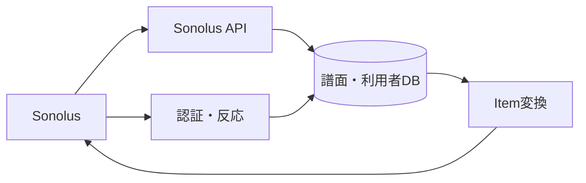

# Sonolus サーバー API 詳細設計書

## 1. 文書情報

| 項目 | 内容 |
|---|---|
| 文書名 | Sonolus サーバー API 詳細設計書 |
| 対象機能 | Sonolus サーバー情報、レベル一覧・詳細、認証、いいね操作 |
| 対象システム | `rp-backend/` |
| バージョン | 1.0 |
| 作成日 | 2026-10-25 |
| 対応する仕様調査書 | [backend_仕様調査書.md](../../00_基本仕様/backend_仕様調査書.md) |
| 関連設計書 | [認証・セッション](./認証・セッション.md)、[ファイル変換](./譜面・音源・画像変換と保管.md) |

## 2. 機能概要

`sonolus-fastapi` による router に Sonolus 向け server/auth/list/detail/actions を登録する。譜面一覧・詳細は DB の Chart を Sonolus `LevelItem` 形式へマッピングし、いいね操作は Sonolus session で認証する。

## 3. 機能仕様

- Sonolus server address は `SOURCE_URL`。
- レベル一覧の基礎条件は未削除・変換完了。公開状態を加えて20件単位の offset pagination を行う。
- キーワード、title、composer、vocal、author、handle、rating、R18、genre を絞り込む。R18 は既定で除外。
- 詳細は LevelItem と actions を返す。ログイン時は既存 like を調べ、LIKE/UNLIKE action を選択する。
- like action 実行には Sonolus session 必須。like 作成でカウンターを加算し、unlike は削除 row がある時だけ減算。
- authenticate は Sonolus ID で RP user を照合し、BAN を拒否、期限を1時間後として session を返す。

## 4. 詳細設計

1. `router/sonolus/index.py` で `Sonolus(router, address=SOURCE_URL)` を構成し、個別 module が decorator で機能を登録する。
2. level list は page を整数化して `offset=20*page` を算出し、条件に一致する rows を `first_published_at desc` で取得する。
3. `to_level_item` は chart の title/rating/artists/author、likes/difficulty/genre/tags、engine/items、cover/BGM/preview/data locator を Sonolus model に組み立てる。
4. detail は chart ID で検索して `to_level_item` を呼び、session があれば session ID から user ID を復号し like row の有無に応じた action を返す。
5. action は session と `values` を検証し、`like` または `unlike` を実行して commit、item update を要求する応答を返す。
6. authenticate は Sonolus profile ID と user を照合し、BAN を拒否して session と expiration を返す。

## 5. データフロー図

## 6. 入出力・データ設計

| 処理 | 入力 | 主な出力 |
|---|---|---|
| Server info | Sonolus request | server item sections |
| Level list | page/search form values | `ServerItemList` (20件/ページ) |
| Level detail | item name, optional session | `ServerItemDetails`, actions |
| Action | item name, session, values | `shouldUpdateItem=true` |
| Authenticate | Sonolus user profile | session、millisecond expiration |

根拠: [router/sonolus/index.py](../../../rp-backend/router/sonolus/index.py)、[level_list.py](../../../rp-backend/router/sonolus/list/level_list.py)、[level_detail.py](../../../rp-backend/router/sonolus/detail/level_detail.py)、[authenticate.py](../../../rp-backend/router/sonolus/authenticate.py)、[utils/sonolus/level.py](../../../rp-backend/utils/sonolus/level.py)

## 7. エラー・例外・制約

- Sonolus framework が最終 HTTP path/protocol marshalling を担うため、その細部は dependency implementation に依存する。
- `get_level_stmt_base()` は未削除・変換完了を条件とするが、list 側で公開条件を追加する。detail 側では公開条件の追加を確認できない。
- count query は list item query と同一の条件を全て適用しているとは限らないため、検索時の pageCount と実際の item 数が一致しない場合がある。
- action に期待外の `values` 形式が来た場合の文字列分割・index error は専用処理されない。

## 8. 設定・外部依存

Sonolus FastAPI/model packages、PostgreSQL、Sonolus session ID utility、`SOURCE_URL` に依存する。

## 9. テスト観点

- 公開・未公開・削除・変換未完了の list/detail 範囲。
- page 0/次 page、フィルター各項目、R18既定値。
- anonymous/detail like state、like/unlike、重複 like および該当 row 不在時。
- BAN/未登録 Sonolus ID の authenticate。
- 自動テストは確認できない。

## 10. バージョン履歴

| バージョン | 日付 | 変更内容 |
|---|---|---|
| 1.0 | 2026-10-25 | 初版作成 |
