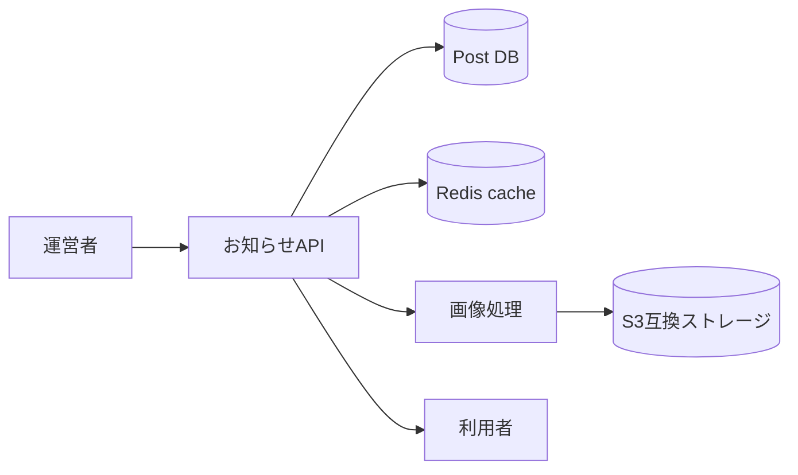

# お知らせ管理 詳細設計書

## 1. 文書情報

| 項目 | 内容 |
|---|---|
| 文書名 | お知らせ管理 詳細設計書 |
| 対象機能 | お知らせ一覧・作成・編集・削除、画像変換 |
| 対象システム | `rp-backend/` |
| バージョン | 1.1 |
| 作成日 | 2026-10-25 |
| 対応する仕様調査書 | [backend_仕様調査書.md](../../00_基本仕様/backend_仕様調査書.md) |
| 関連設計書 | [起動・データ保管](./起動・データ保管.md)、[運営情報・OGP](./運営情報・共有用OGP.md) |

## 2. 機能概要

お知らせを `PostItem` として管理する。GET はピン留めされたお知らせをキャッシュ経由で返し、moderator 以上が作成・編集・削除を行える。サムネイル・バナーは非同期変換タスクに渡す。

## 3. 機能仕様

- GET `/api/announce` は pin 済み項目を `updated_at desc` で返す。コード上は認証依存がなく、Redis cache が存在すれば `AnnounceListAdapter.validate_json(..., by_alias=True)` で response schema として検証して返す。camelCase alias を含む cache JSON も受理する。
- POST は JSON data、thumbnail、banner を multipart で必須受信し、新しい post row の commit 後に2つの変換 task を enqueue。
- PUT は任意 data/thumbnail/banner。対象が存在し、announce type (`is_pinned`) であることを確認する。
- DELETE は対象 post を削除して commit 後、存在する画像 hash の S3 key を削除する。

## 4. 詳細設計

1. GET は Redis cache key を取得する。cache hit 時は `TypeAdapter.validate_json` を `by_alias=True` で実行し、schema field alias 名でも JSON を読み取る。miss 時は pinned posts を著者と共に取得し、response object を組み立て、TTL 付きで cache 保存する。
2. POST は request schema を parse、画像 bytes を読み込んで個別サイズ上限を確認し、moderator 権限を検査する。
3. 新規 ID を生成して pinned PostItem を作成・commit し、thumbnail/banner task を enqueue、post ID を返す。
4. PUT は moderator 権限、対象存在、pinned 状態を検査。送られた text fields を更新して commit し、送信ファイルごとに task を enqueue。
5. DELETE は moderator 権限、対象・種別を確認し、既存 hash がある画像 key を収集。row 削除・commit 後に `delete_s3` を呼ぶ。

## 5. データフロー図

## 6. 入出力・データ設計

| API | 入力 | 保存・出力 |
|---|---|---|
| GET | なし | announcements list |
| POST | title/subtitle/displayName/description、thumbnail、banner | post ID |
| PUT | `post_id`、optional text JSON、optional files | 空応答 |
| DELETE | `post_id` | row 削除・画像削除 |

画像 file size は `const/post.py` の `PostFileSize` 定数で検証される。根拠: [announce.py](../../../rp-backend/router/web/announce.py)、[requests.py](../../../rp-backend/schemas/requests.py)、[convert_tasks.py](../../../rp-backend/utils/convert_tasks.py)

## 7. エラー・例外・制約

- 認証利用者不存在、権限不足、post 不在、announce 以外の post、file 超過を例外化する。
- GET cache 内容が壊れている場合や alias 以外の不正項目を含む場合の専用 fallback はなく、validation error となる可能性がある。
- 作成・編集 task enqueue と DB commit は別処理で、enqueue 失敗時の補償は確認できない。
- GET の cache invalidation は create/edit/delete handler で確認できない。

## 8. 設定・外部依存

PostgreSQL、Redis、Celery、S3互換ストレージ、画像変換処理に依存する。

## 9. テスト観点

- cache hit/miss、空リスト、期限切れ、cache JSON 不正。
- create/update/delete 権限、post type、file size、task enqueue。
- 画像差し替えと旧画像削除。
- 自動テストは確認できない。

## 10. バージョン履歴

| バージョン | 日付 | 変更内容 |
|---|---|---|
| 1.0 | 2026-10-25 | 初版作成 |
| 1.1 | 2026-10-25 | お知らせcacheのalias対応読込を反映。 |
