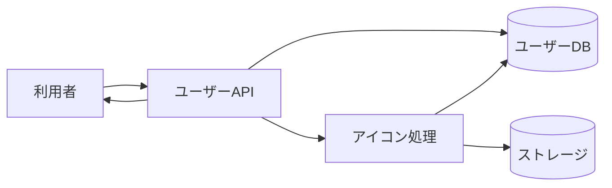

# ユーザー情報・プロフィール管理 詳細設計書

## 1. 文書情報

| 項目 | 内容 |
|---|---|
| 文書名 | ユーザー情報・プロフィール管理 詳細設計書 |
| 対象機能 | ユーザー取得、ユーザー検索、プロフィール・権限編集、アイコン更新 |
| 対象システム | `rp-backend/` |
| バージョン | 1.0 |
| 作成日 | 2026-10-25 |
| 対応する仕様調査書 | [backend_仕様調査書.md](../../00_基本仕様/backend_仕様調査書.md) |
| 関連設計書 | [認証・セッション](./認証・セッション.md) |

## 2. 機能概要

`GET /api/user` と `GET /api/users` はユーザー情報を返す。`PUT /api/user` はプロフィール・権限の一部更新と任意のアイコン差し替えを受け付ける。

## 3. 機能仕様

- 単一ユーザー取得は user ID 必須。匿名アクセス可能で、permission は本人または moderator 以上だけ、warning count は moderator 以上だけに含める。
- ユーザー検索は name / permission で最大20件。BAN permission 検索は moderator 以上が必要。
- 編集は本人、または target より高い権限の moderator 以上に限定。本人が自身の permission を変更できない。
- profile は200文字以内。icon file は `UserFileSize.ICON` 以下。画像変換・S3 保存は BackgroundTasks で行う。

## 4. 詳細設計

### 読み取り

1. user ID で対象を取得し、不在なら `UserNotFound`。
2. optional auth ID がある場合は操作ユーザーを解決する。
3. レスポンスを構築し、本人・moderator 以外には permission を設定しない。warning count は moderator のみに設定する。
4. `/users` は `limit(20)` を適用し、name は小文字化して部分一致検索する。permission 指定時は BAN 値のみ moderator 権限を追加検査する。

### 更新

1. multipart `data` がある場合 `UserEditRequest` として parse する。target/operator の両 user を取得する。
2. 他者編集の場合、operator が moderator 未満または target の権限が operator 以上なら拒否する。
3. 指定された name/profile/permission を更新する。permission は自己変更不可、operator より高い値に設定不可。
4. icon file があれば読み込み、サイズ上限を確認し、画像更新を BackgroundTasks へ登録する。
5. DB を commit して空の Response を返す。アイコン処理は別 session で画像を中央正方形 crop、所定寸法の JPEG 化、hash 付き key で S3 保存する。

## 5. データフロー図

## 6. 入出力・データ設計

| API | 入力 | 主な出力・制約 |
|---|---|---|
| `GET /api/user` | `user_id`, optional Cookie | user detail; permission/warning は権限に応じて省略 |
| `GET /api/users` | optional `name`, `permission` | 最大20件 |
| `PUT /api/user` | `target_user_id`, optional JSON `data`, optional `icon_file` | name/profile/permission、profile ≤200、icon 上限は定数 |

根拠: [get_user.py](../../../rp-backend/router/web/user/get_user.py)、[edit_user.py](../../../rp-backend/router/web/user/edit_user.py)、[requests.py](../../../rp-backend/schemas/requests.py)、[converter.py](../../../rp-backend/utils/converter.py)

## 7. エラー・例外・制約

- 存在しない対象または操作ユーザーは `UserNotFound`。権限不足は `NoPermission`。
- profile 長制限違反は Pydantic validation error。icon 超過は `FileSizeTooLarge`。
- BackgroundTasks の icon 変換失敗を API 応答へ反映する処理は確認できない。
- 他者向けの `permission` 更新は operator より高い権限を拒否するが、外部 role 同期はこの endpoint で確認できない。

## 8. 設定・外部依存

PostgreSQL、S3 互換ストレージ、Pillow/OpenCV 系画像処理に依存する。Cookie 認証は本人・管理者判定に利用される。

## 9. テスト観点

- 匿名／本人／moderator の表示項目差。
- BAN permission 検索の権限境界、検索件数上限。
- 自己編集、他者編集の権限比較、自己権限変更拒否。
- profile と icon サイズ境界、icon 処理成功・失敗。
- 自動テストは確認できない。

## 10. バージョン履歴

| バージョン | 日付 | 変更内容 |
|---|---|---|
| 1.0 | 2026-10-25 | 初版作成 |
