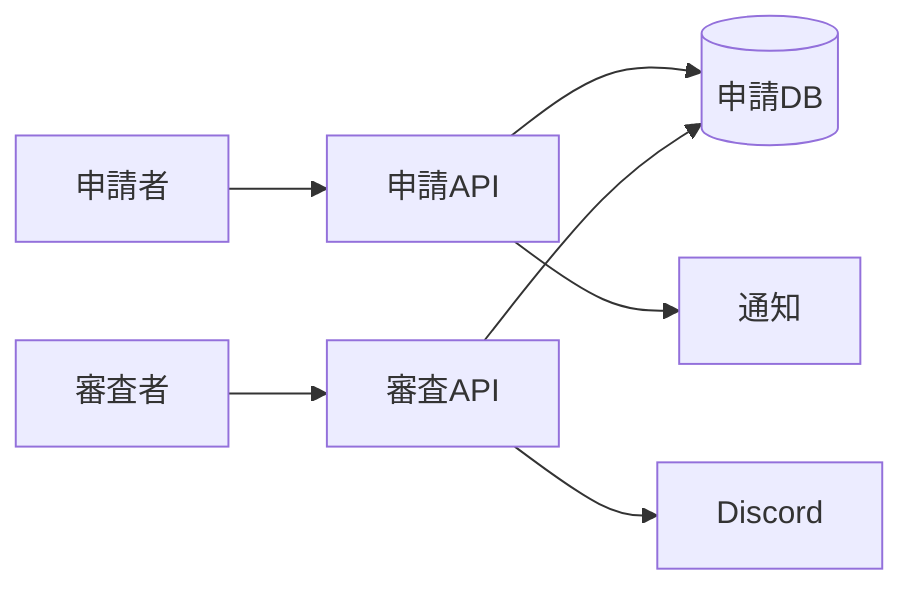

# 制作者認定申請・審査 詳細設計書

## 1. 文書情報

| 項目 | 内容 |
|---|---|
| 文書名 | 制作者認定申請・審査 詳細設計書 |
| 対象機能 | 申請の作成・閲覧、審査者一覧、承認／却下 |
| 対象システム | `rp-backend/` |
| バージョン | 1.0 |
| 作成日 | 2026-10-25 |
| 対応する仕様調査書 | [backend_仕様調査書.md](../../00_基本仕様/backend_仕様調査書.md) |
| 関連設計書 | [認証・セッション](./認証・セッション.md)、[ユーザー情報](./ユーザー情報・プロフィール管理.md) |

## 2. 機能概要

通常権限ユーザーが自身の変換完了済み譜面で認定制作者を申請し、認定制作者以上が申請を閲覧・審査する。承認2件または却下2件で申請を閉じる。

## 3. 機能仕様

- 申請者自身が作成した chart、NORMAL 権限、変換完了が必要。
- 申請者単位で未完了申請がある間は新規申請不可。
- 申請者は自身の一覧・詳細、認定制作者以上は全体 pending 一覧・詳細を閲覧可能。
- 認定制作者以上は各申請に一度だけ decision を登録できる。
- 承認が2件で申請者を CHARTER に更新し、Discord role を付与。却下2件でも申請を閉じる。
- 申請作成後、Discord 通知 URL を含む通知を background task に登録する。

## 4. 詳細設計

1. POST request は multipart の JSON `data` から `chart_id` を読み取る。
2. user/chart の存在、自分の chart であること、permission が NORMAL であること、conversion status が COMPLETE であることを確認する。
3. 同じ申請者に open request がないことを DB count で確認する。
4. 新規 request ID を生成し、request row を commit する。commit 後に reviewer 通知 BackgroundTask を追加する。
5. pending 一覧は open request を `created_at asc` で返す。ユーザー一覧は本人分を `created_at desc` で返す。request detail は申請者本人または認定制作者以上に制限する。
6. 審査 POST は request/user を取得し、reviewer 権限、open 状態、既存 reviewer decision の有無を検査する。
7. approval row を flush してから全 decision を数える。reject が2以上なら request を閉じる。approve が2以上なら申請者 permission を CHARTER、request を closed に設定する。
8. 承認成立時は Discord API に role 付与を依頼する。HTTP 204 以外なら DB rollback の上 HTTP 500。最後に commit する。

## 5. データフロー図

## 6. 入出力・データ設計

| API | 入力 | 出力 |
|---|---|---|
| `POST /api/auth/charter/request` | multipart JSON `chart_id` | request ID |
| `GET /api/auth/charter/requests` | `target_user_id` | 対象ユーザーの request list |
| `GET /api/auth/charter/requests/pending` | auth cookie | open request list |
| `GET /api/auth/charter/request` | `request_id` | request state, chart, applicant, approvals |
| `POST /api/auth/charter/approval` | `request_id`, `status`, optional `reason` | 空応答 |

根拠: [auth_charter.py](../../../rp-backend/router/web/user/auth_charter.py)、[requests.py](../../../rp-backend/schemas/requests.py)、[const/user.py](../../../rp-backend/const/user.py)

## 7. エラー・例外・制約

- 自分以外の chart、NORMAL 以外、未変換 chart、open request 重複、権限外審査、同一 reviewer の再審査は拒否される。
- Discord role 付与失敗は DB 更新を rollback し HTTP 500。
- Discord 通知 task は background 実行であり、その成否は申請作成応答に反映されない。
- 承認数・却下数の閾値は `const/user.py` の定数を使用する。

## 8. 設定・外部依存

PostgreSQL、Discord API、bot token、guild/role 設定、通知先に依存する。資格情報は記載しない。

## 9. テスト観点

- 申請の各前提、open request の二重作成拒否。
- request 一覧・詳細の閲覧権限。
- 1 reviewer の二重投票、approve/reject 各2件時の状態遷移。
- role API 204／非204時の commit/rollback。
- 自動テストは確認できない。

## 10. バージョン履歴

| バージョン | 日付 | 変更内容 |
|---|---|---|
| 1.0 | 2026-10-25 | 初版作成 |
