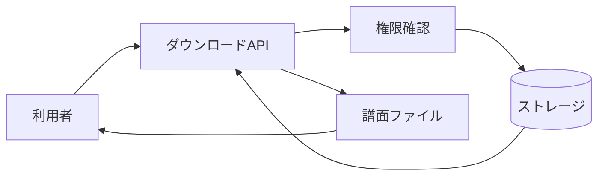

# 原本譜面ダウンロード 詳細設計書

## 1. 文書情報

| 項目 | 内容 |
|---|---|
| 文書名 | 原本譜面ダウンロード 詳細設計書 |
| 対象機能 | `GET /api/chart/download` |
| 対象システム | `rp-backend/` |
| バージョン | 1.0 |
| 作成日 | 2026-10-25 |
| 対応する仕様調査書 | [backend_仕様調査書.md](../../00_基本仕様/backend_仕様調査書.md) |
| 関連設計書 | [譜面詳細・自分の譜面](./譜面詳細・自分の譜面.md)、[ファイル変換](./譜面・音源・画像変換と保管.md) |

## 2. 機能概要

認証済み利用者が権限条件を満たす場合、S3 互換ストレージに保存された圧縮原本を取得し、zstd 解凍した譜面ファイルをダウンロードする。

## 3. 機能仕様

- NORMAL 未満の利用者は拒否される。
- 原本公開設定が PUBLIC、譜面作者本人、または MODERATOR 以上の場合に取得可能。
- ストレージ URL へ HTTP GET し、status code 200 以外は `ChartFileDownloadError`。
- 成功時の `Content-Type` は `application/octet-stream`、ファイル名は `{chart_id}.{chart.chart_format}`。

## 4. 詳細設計

1. Cookie から認証ユーザーを解決し、DB 上のユーザーを取得する。
2. ユーザーが存在しない場合は `UserNotFound`、NORMAL 未満なら `UserBanned`。
3. chart を取得し、存在しなければ `ChartNotFound`。
4. `original_chart_publish_status` が非公開であり、本人でも moderator 以上でもない場合は `NoPermission`。
5. `chart.original_chart_url` に HTTP GET する。200 以外の応答はダウンロードエラーとする。
6. 応答 bytes を zstd 解凍し、その bytes を添付ファイルとして返す。

## 5. データフロー図

## 6. 入出力・データ設計

| 項目 | 内容 |
|---|---|
| Query | `chart_id` |
| 認証 | Cookie を介した `get_current_user_id` |
| 保存データ | zstd 圧縮された原本 |
| 応答 | 解凍 bytes、octet-stream、chart format 拡張子 |

根拠: [download_chart.py](../../../rp-backend/router/web/chart/download_chart.py)、[convert_tasks.py](../../../rp-backend/utils/convert_tasks.py)

## 7. エラー・例外・制約

- 外部 GET に対する明示 timeout は endpoint 内で設定されていない。
- ストレージアクセス例外、zstd 解凍失敗の endpoint 固有変換は確認できない。
- 原本 URL が未設定の場合の応答は要確認。

## 8. 設定・外部依存

認証、PostgreSQL、S3 互換 HTTP endpoint、zstd decoder に依存する。

## 9. テスト観点

- 未ログイン、BAN、非公開原本の非本人、本人、moderator、公開原本。
- ストレージ status 200／非200、zstd 正常／不正 bytes。
- response headers とファイル名。
- 自動テストは確認できない。

## 10. バージョン履歴

| バージョン | 日付 | 変更内容 |
|---|---|---|
| 1.0 | 2026-10-25 | 初版作成 |
