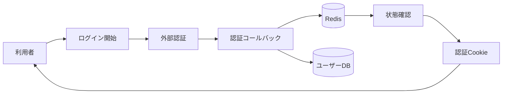

# 認証・セッション 詳細設計書

## 1. 文書情報

| 項目 | 内容 |
|---|---|
| 文書名 | 認証・セッション 詳細設計書 |
| 対象機能 | Discord OAuth、Sonolus ログイン、JWT Cookie、refresh/logout |
| 対象システム | `rp-backend/` |
| バージョン | 1.1 |
| 作成日 | 2026-10-25 |
| 対応する仕様調査書 | [backend_仕様調査書.md](../../00_基本仕様/backend_仕様調査書.md) |
| 関連設計書 | [ユーザー管理](./ユーザー情報・プロフィール管理.md)、[Sonolus API](./SonolusサーバーAPI.md) |

## 2. 機能概要

Web API の認証状態を JWT の HttpOnly Cookie で保持する。ログイン入口は Discord OAuth と Sonolus External Login。Sonolus 認証では Redis に期限付き状態を保存し、ブラウザーから状態を確認して Cookie を取得する。

## 3. 機能仕様

- access token は1日、refresh token は30日。共に HS256 JWT。
- Cookie は HttpOnly、SameSite=Lax。access path `/`、refresh path `/api/auth/refresh`。コード上 `secure=True` はコメントアウト。
- `/api/login` は現在のユーザー情報を返す。`/api/logout` は Cookie を削除する。
- Discord 初回 login は新規ユーザーを作成し、Discord admin/moderator role に基づき初期 permission を設定する。既存 BAN user は拒否する。
- Sonolus login session は Redis TTL 付きで作成され、callback の署名、時刻（±300000ms）、`auth_id` を含むURLを検証する。Sonolus account link callback は署名、時刻、および `token` query を含む完全な送信先URLを検証する。
- `/api/auth/status` は pending 時202、完了時200と Cookie を発行し、Redis key を削除する。

## 4. 詳細設計

1. `GET /discord/login` は設定済み OAuth URL へ redirect する。
2. `/discord/callback` は受け取った code を Discord token endpoint に渡し、guild member 情報から Discord ID/name/roles を取得する。
3. Discord ID で既存ユーザーを検索し、なければ新規 ID と初期権限で登録する。BAN 済みなら拒否し、正常なら access/refresh Cookie を付けて `/` へ redirect する。
4. `/sonolus/login` は auth ID を発行し Redis に `{user_id:null}` を TTL 付き保存、外部ログイン URL を返す。
5. callback は署名・timestamp・request URL を検証し、Sonolus ID から RP user を検索する。BAN、未リンク、セッション不在は拒否し、有効な Redis record に user ID を保存する。
6. `/auth/status` は Redis record を読み、user ID 未設定なら pending。設定済みなら key を削除し Cookie を設定して completed を返す。
7. `/auth/refresh` は refresh Cookie を decode、ユーザーの存在と BAN を検査し、両 Cookie を再設定する。
8. `/logout` は両 Cookie に削除指示を返す。

### Sonolus account link

1. `GET /sonolus/link` はログイン user ID を埋め込んだ Sonolus session token を生成し、外部ログイン URL の `token` query に付けて redirect する。
2. `/sonolus/link/callback` は query `token` を受け取り、署名および timestamp を検証する。
3. `body.url` が `HOST_URL/api/sonolus/link/callback?token={token}` と完全一致することを確認する。不一致は403。
4. token から user ID を復号し、対象ユーザーの Sonolus ID/name/handle を更新して commit する。

## 5. データフロー図

## 6. 入出力・データ設計

| API | 主な入力 | 応答・状態 |
|---|---|---|
| `GET /discord/login` | なし | Discord OAuth redirect |
| `GET /discord/callback` | `code` | `/` redirect、Cookie |
| `POST /sonolus/login` | なし | `auth_id`, `auth_url` |
| `POST /sonolus/login/callback` | `auth_id`, Sonolus request body/header | Redis session の user_id 更新 |
| `GET /auth/status` | `auth_id` | pending 202 / completed 200＋Cookie |
| `GET /sonolus/link` | 認証 Cookie | Sonolus 外部ログインへ redirect。token query を付与 |
| `POST /sonolus/link/callback` | query `token`、署名 header、認証 body | token・送信先を検証後、user の Sonolus 情報を更新 |
| `POST /auth/refresh` | refresh Cookie | 新しい access/refresh Cookie |
| `GET /login`, `POST /logout` | Cookie | user detail / Cookie 削除 |

根拠: [auth.py](../../../rp-backend/router/web/user/auth.py)、[discord.py](../../../rp-backend/router/web/user/discord.py)、[sonolus.py](../../../rp-backend/router/web/user/sonolus.py)、[utils/auth.py](../../../rp-backend/utils/auth.py)

## 7. エラー・例外・制約

- refresh Cookie 欠落は必須 Cookie の request validation 対象。値が無効・期限切れの場合は JWT decode が401を返し、ユーザー不存在・BAN も拒否される。
- Sonolus login callback は署名なし400、不正署名・期限切れ・URL不一致403、ユーザー/Redis record 不在404などを返す。link callback の送信先URLには受信した `token` query が含まれることを要求する。
- Discord API 応答の status code / payload shape を包括的に検証するコードは確認できない。
- Cookie の `secure` 属性は明示的に設定されていない。

## 8. 設定・外部依存

JWT secret、Discord OAuth/API/guild/role、Redis、HOST_URL が必要。実値は [const/env.py](../../../rp-backend/const/env.py) から参照されるが、本書には記載しない。

## 9. テスト観点

- access/refresh 有効期限と Cookie 属性、logout 後の削除 path。
- Discord 新規・既存・BAN・role 分岐。
- Sonolus signature/time/url/session の各境界、pending/completed。
- Sonolus link callback の token query 一致・不一致、および成功時の Sonolus profile 更新。
- refresh 時のユーザー状態、HTTPエラー。自動テストは確認できない。

## 10. バージョン履歴

| バージョン | 日付 | 変更内容 |
|---|---|---|
| 1.0 | 2026-10-25 | 初版作成 |
| 1.1 | 2026-10-25 | Sonolus link callbackのtoken付きURL検証を反映。 |
