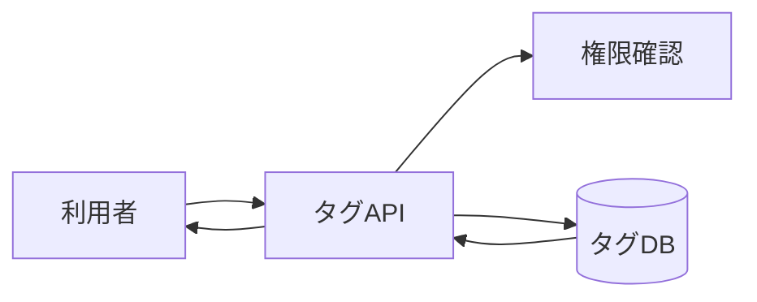

# 譜面タグ管理 詳細設計書

## 1. 文書情報

| 項目 | 内容 |
|---|---|
| 文書名 | 譜面タグ管理 詳細設計書 |
| 対象機能 | タグ一覧、タグ追加、タグ削除 |
| 対象システム | `rp-backend/` |
| バージョン | 1.0 |
| 作成日 | 2026-10-25 |
| 対応する仕様調査書 | [backend_仕様調査書.md](../../00_基本仕様/backend_仕様調査書.md) |
| 関連設計書 | [譜面検索](./譜面検索.md)、[譜面投稿](./譜面投稿.md) |

## 2. 機能概要

`/api/chart/tag` でタグ master を一覧、追加、削除する。追加・削除は MODERATOR 以上に限定する。

## 3. 機能仕様

- GET は全タグを ID/title/icon/createdAt/updatedAt として返す。認証依存はない。
- POST は `title` と optional Sonolus icon を受け付け、重複 title を拒否する。
- DELETE は tag ID を受け付け、chart-tag relation を先に削除後、master を削除する。

## 4. 詳細設計

1. POST/DELETE は Cookie user を取得し、存在確認と moderator 権限を検査する。
2. POST は同一 title の有無を照会し、重複時は `TagDuplicated`。未重複なら creator ID と共に master を作成して commit。
3. DELETE は user と tag master を取得し、どちらか不在なら対応例外を返す。
4. 削除対象 tag ID を持つ全 ChartTag relation を DELETE し、master row を削除して commit。
5. GET は ChartTagMaster 全件を読み込み、response schema に変換して返す。

## 5. データフロー図

## 6. 入出力・データ設計

| Method | 入力 | 出力 |
|---|---|---|
| GET | なし | tag response list |
| POST | JSON title、optional icon | 成功時 commit |
| DELETE | query `tag_id` | 成功時 commit |

根拠: [tag.py](../../../rp-backend/router/web/chart/tag.py)、[requests.py](../../../rp-backend/schemas/requests.py)、[responses.py](../../../rp-backend/schemas/responses.py)

## 7. エラー・例外・制約

- POST/DELETE で user 不在・権限不足、DELETE で tag 不在、POST で title 重複を例外化する。
- title の長さ・空文字に対する endpoint 固有検証は確認できない。
- 既存譜面についた関連は削除と同じ transaction 内で消える。

## 8. 設定・外部依存

PostgreSQL、Sonolus icon enum、Cookie 認証に依存する。

## 9. テスト観点

- 匿名一覧取得、moderator 未満の追加・削除拒否。
- duplicate title、icon 省略、tag 不在。
- tag 削除後の関連 row 削除。
- 自動テストは確認できない。

## 10. バージョン履歴

| バージョン | 日付 | 変更内容 |
|---|---|---|
| 1.0 | 2026-10-25 | 初版作成 |
