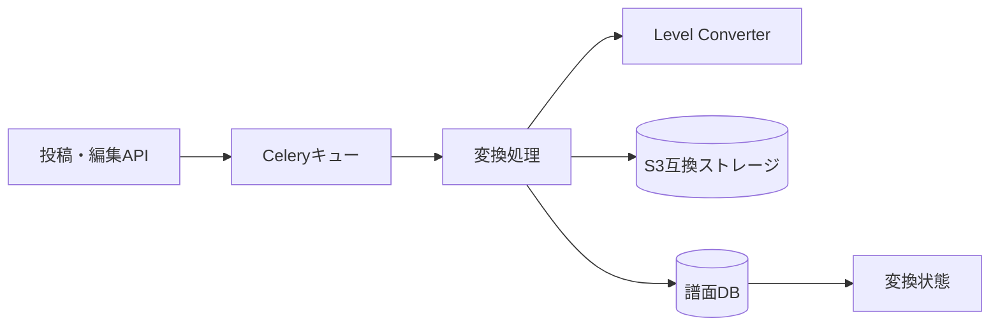

# 譜面・音源・画像変換と保管 詳細設計書

## 1. 文書情報

| 項目 | 内容 |
|---|---|
| 文書名 | 譜面・音源・画像変換と保管 詳細設計書 |
| 対象機能 | Celery 変換タスク、S3 保存、変換状態更新 |
| 対象システム | `rp-backend/` |
| バージョン | 1.0 |
| 作成日 | 2026-10-25 |
| 対応する仕様調査書 | [backend_仕様調査書.md](../../00_基本仕様/backend_仕様調査書.md) |
| 関連設計書 | [譜面投稿](./譜面投稿.md)、[譜面編集](./譜面編集.md)、[原本ダウンロード](./原本譜面ダウンロード.md) |

## 2. 機能概要

投稿・差し替え時に個別タスクを実行し、譜面を LevelData、BGM を再生用・プレビュー用 MP3、ジャケットを PNG と背景画像へ変換する。変換結果を S3 互換ストレージに置き、URL/hash と完了 bit を DB に保存する。

## 3. 機能仕様

- Celery は Redis を broker/backend に用いる。task serializer/result serializer は JSON、timezone は Asia/Tokyo。
- 各タスクは処理前に変換し、結果の SHA-1 を key/hash として保存する。
- 成功時に既存オブジェクトを削除候補にし、DB 更新後に削除する。
- chart conversion status は譜面=1、BGM=2、ジャケット=4。全 bit が有効な値は7。
- 元譜面は zstd level 3 で圧縮、LevelData は gzip JSON として保存する。

## 4. 詳細設計

### 譜面

`convert_chart` が Level Converter の `/convert` に30秒 timeout で POST。HTTP 200 以外は変換失敗。応答 `chartformat` と `leveldata` を取り出し、leveldata JSON を gzip 化する。原本 bytes は zstd 圧縮し、両オブジェクトをアップロード後、URL/hash/format/version と CHART_COMPLETE を更新する。現行コードでは `chart.version = SonolusItemVersion.LEVEL_ITEM,` と末尾カンマ付きで代入しているため、Python 上は単一要素 tuple になる。DB field との整合・保存結果は要確認。

### BGM

`convert_bgm` はプレイ用 MP3（192 kbit/s）と、指定 start time から15秒の mono preview MP3（128 kbit/s）を生成する。各 hash/URL と BGM_COMPLETE を更新する。

### ジャケット

入力画像をアスペクト比を保って最大500×500へ縮小し、黒背景の500×500 RGB画像に整える。背景画像を合成し、双方を PNG 保存する。新しい背景 item を DB 登録し、譜面のジャケット参照と JACKET_COMPLETE を更新する。

タスク内の例外は broad catch され、存在する session を rollback するが、利用者へのタスク失敗応答・ログ記録はこのファイルでは確認できない。

## 5. データフロー図

## 6. 入出力・データ設計

| 入力 | 出力 | 永続化 |
|---|---|---|
| 譜面 bytes | chart format、gzip LevelData、zstd 原本 | chart URL/hash/format/version |
| BGM bytes、preview start | MP3、15秒 preview MP3 | BGM/preview URL/hash |
| ジャケット bytes | 500×500 PNG、背景 PNG | jacket URL/hash、BackgroundItem |

根拠: [convert_tasks.py](../../../rp-backend/utils/convert_tasks.py)、[converter.py](../../../rp-backend/utils/converter.py)、[const/chart.py](../../../rp-backend/const/chart.py)

## 7. エラー・例外・制約

- Level Converter への HTTP は30秒 timeout、非200は HTTP 500 相当の変換失敗。
- Celery task の broad catch は例外を利用者へ伝播させず、rollback のみ行う。完了 bit が未設定で残る可能性がある。
- ffmpeg、Pillow/OpenCV、S3、DB、Level Converter の障害は個別の再試行条件が task 内で確認できない。
- S3 アップロード成功後に DB 更新失敗した場合の孤立オブジェクト補償は確認できない。

## 8. 設定・外部依存

Redis/Celery、PostgreSQL、S3互換ストレージ、Level Converter、ffmpeg、画像変換ライブラリ、Sonolus item resource。

## 9. テスト観点

- 各媒体変換の形式・hash・storage key・DB参照更新。
- 既存 hash の差し替え時に古いファイルを消す条件。
- converter timeout／非200、破損画像・音声、S3失敗、DB失敗の状態。
- 各タスク例外時に変換完了 bit が設定されないこと。既存自動テストは確認できない。

## 10. バージョン履歴

| バージョン | 日付 | 変更内容 |
|---|---|---|
| 1.0 | 2026-10-25 | 初版作成 |
