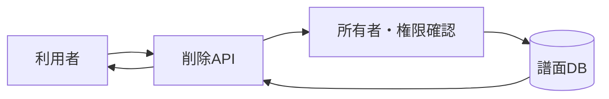

# 譜面削除 詳細設計書

## 1. 文書情報

| 項目 | 内容 |
|---|---|
| 文書名 | 譜面削除 詳細設計書 |
| 対象機能 | `DELETE /api/chart` |
| 対象システム | `rp-backend/` |
| バージョン | 1.0 |
| 作成日 | 2026-10-25 |
| 対応する仕様調査書 | [backend_仕様調査書.md](../../00_基本仕様/backend_仕様調査書.md) |
| 関連設計書 | [譜面編集](./譜面編集.md)、[原本ダウンロード](./原本譜面ダウンロード.md) |

## 2. 機能概要

譜面を物理削除せず、`Chart.is_deleted` を true にして論理削除する。譜面作者本人または administrator のみ実行できる。

## 3. 機能仕様

- 認証ユーザー、譜面、背景 item を取得する。
- 権限の条件は通常以上かつ作者本人または administrator。
- DB commit により論理削除状態を永続化する。
- S3 オブジェクト削除、関連する合作・タグ・いいね・譜面・背景レコードの物理削除処理はコメントアウトされている。

## 4. 詳細設計

1. ユーザー、譜面、背景を DB から取得する。
2. ユーザー、譜面、背景の存在とユーザー権限を検査する。
3. `is_owner` と `is_admin` を計算し、どちらも false なら拒否する。moderator 権限だけでは削除できない。
4. `chart.is_deleted = True` とし、commit する。

実装では背景取得時に `chart.background_item_id` を参照しており、譜面不存在の検査より先に chart を参照する順序になっている。

## 5. データフロー図

## 6. 入出力・データ設計

| 項目 | 形式 |
|---|---|
| `chart_id` | query string |
| `access_token` | 認証 Cookie |
| DB 更新 | `Chart.is_deleted = true` |
| 成功応答 | 明示的な response body なし |

根拠: [delete_chart.py](../../../rp-backend/router/web/chart/delete_chart.py)

## 7. エラー・例外・制約

- ユーザー、譜面、背景が取得できない場合は対応する `RPException` を投げる実装だが、譜面不存在時に先行する背景取得で例外になる可能性がある。
- DB に論理削除状態は残る。S3 の削除は本 API では行われない。

## 8. 設定・外部依存

PostgreSQL と認証 Cookie に依存する。S3 削除依存関数は import されているが処理はコメントアウトされている。

## 9. テスト観点

- 作者本人／administrator／moderatorのみ／無関係ユーザーの権限境界。
- 対象譜面と背景の有無、論理削除後も DB レコード・オブジェクトが残ること。
- 譜面不存在時の実際の例外経路。
- 自動テストは確認できない。

## 10. バージョン履歴

| バージョン | 日付 | 変更内容 |
|---|---|---|
| 1.0 | 2026-10-25 | 初版作成 |
