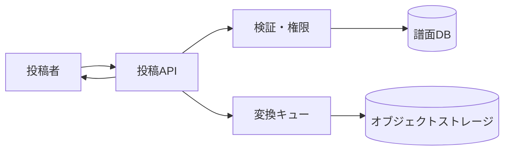

# 譜面投稿 詳細設計書

## 1. 文書情報

| 項目 | 内容 |
|---|---|
| 文書名 | 譜面投稿 詳細設計書 |
| 対象機能 | `POST /api/chart` |
| 対象システム | `rp-backend/` |
| バージョン | 1.0 |
| 作成日 | 2026-10-25 |
| 対応する仕様調査書 | [backend_仕様調査書.md](../../00_基本仕様/backend_仕様調査書.md) |
| 関連設計書 | [ファイル変換](./譜面・音源・画像変換と保管.md)、[譜面編集](./譜面編集.md) |

## 2. 機能概要

ログイン済み利用者から譜面メタデータと譜面・BGM・ジャケットを受け取り、譜面 DB レコードを作成した後、ファイルごとの変換タスクを Celery に投入する。

## 3. 機能仕様

- multipart の `data` は JSON 文字列。譜面、BGM、ジャケットは必須。
- `title`, `composer`, `vocal`, `displayName` は各50文字以内、`description` は200文字以内、`rating` は0〜50、合作20名以内、タグ4件以内。`startTime` は0以上かつ有限値。
- ファイル上限は譜面60 MiB、BGM30 MiB、ジャケット5 MiB。
- 通常権限は未削除の自分の譜面を既に持つ場合投稿不可。通常権限は合作・タグ不可。
- 通常より上の権限には非公開5件、全譜面100件の投稿枠制限を適用する。
- 入力 `publishStatus=PUBLIC` でも初回は `PRIVATE` 保存。予約投稿スケジュール登録処理はコメントアウトされている。

## 4. 詳細設計

1. `data` を JSON decode し `ChartPostRequest` で検証する。
2. 認証済みユーザーを取得し、存在・権限・投稿数制限を確認する。
3. 3ファイルを全て読み込み、各サイズ上限を超えた場合 `FileSizeTooLarge`。
4. サービス prefix と生成 ID を連結して chart ID を作成する。
5. 存在するタグ ID のみ関連付けし、存在する collaborator user ID のみ登録する。
6. 公開指定を非公開へ変更し、譜面レコードを作成して commit する。
7. `upload_jacket`, `upload_bgm(start_time)`, `upload_chart` を個別に enqueue し、chart ID を返す。

## 5. データフロー図

## 6. 入出力・データ設計

| 項目 | 必須 | 型・制約 |
|---|---:|---|
| `data` | はい | JSON、`ChartPostRequest` |
| `chart_file` | はい | binary、最大60 MiB |
| `bgm_file` | はい | binary、最大30 MiB |
| `jacket_file` | はい | binary、最大5 MiB |
| `startTime` | はい | 有限数、0以上 |
| 応答 | — | 作成された chart ID |

根拠: [post_chart.py](../../../rp-backend/router/web/chart/post_chart.py)、[requests.py](../../../rp-backend/schemas/requests.py)、[const/chart.py](../../../rp-backend/const/chart.py)

## 7. エラー・例外・制約

- JSON/Pydantic 検証失敗、権限不足、投稿枠超過、ファイル過大は例外応答になる。
- DB commit 後のタスク投入で失敗した場合の補償処理は endpoint 内にない。
- 存在しないタグ・協力者 ID はエラーではなく関連付け対象から除外される。
- `SCHEDULED` は schema で受理されるが、この投稿 handler から schedule を起動しない。

## 8. 設定・外部依存

PostgreSQL、Celery/Redis、S3互換ストレージ、譜面変換サービス、画像・音声変換依存に連携する。

## 9. テスト観点

- 必須項目、各文字数・数値境界、各ファイル上限。
- NORMAL の既存投稿・タグ・合作制限と上位権限の投稿枠。
- PUBLIC 入力の PRIVATE 保存、SCHEDULED 入力の未スケジュール動作。
- DB 登録と3タスクの投入引数。自動テストは確認できない。

## 10. バージョン履歴

| バージョン | 日付 | 変更内容 |
|---|---|---|
| 1.0 | 2026-10-25 | 初版作成 |
