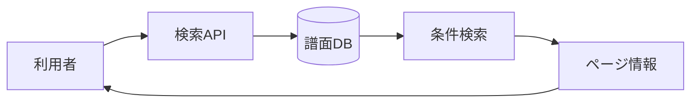

# 譜面検索 詳細設計書

## 1. 文書情報

| 項目 | 内容 |
|---|---|
| 文書名 | 譜面検索 詳細設計書 |
| 対象機能 | 公開譜面検索、条件絞り込み、カーソルページング |
| 対象システム | `rp-backend/` |
| バージョン | 1.0 |
| 作成日 | 2026-10-25 |
| 対応する仕様調査書 | [backend_仕様調査書.md](../../00_基本仕様/backend_仕様調査書.md) |
| 関連設計書 | [譜面詳細・自分の譜面](./譜面詳細・自分の譜面.md) |

## 2. 機能概要

`GET /api/chart/search` が公開・未削除の譜面を検索し、一覧と次ページ情報を返す。利用者はキーワード、レベル、R18、合作、難易度、ジャンル、タグ、イベント、ユーザー、並び順で絞り込む。

## 3. 機能仕様

- `sort_type`: `new` または `likes`、既定値 `new`。
- `order`: `asc` または `desc`、既定値 `desc`。
- レベル既定値は0〜50、R18除外、合作限定なし、`limit` 既定値20。
- 最終的な件数は1〜20に丸める。対象は `is_deleted = false` かつ `publish_status = PUBLIC`。
- 応答は `charts`, `next`, `cursor`。各一覧項目には譜面メタデータ、作者・ジャケット、イベント、タグが含まれる。

## 4. 詳細設計

1. `limit` を `[1,20]` に制限し、`min_rating` は最大50、`max_rating` は最低0に補正する。
2. 基本条件として公開・未削除・レベル範囲を適用する。
3. 並び順は新着なら初回公開時刻と ID、いいね数なら like count と ID を組み合わせる。昇降順に応じてカーソル比較条件を切り替える。
4. カーソルは Base64 化した `値,譜面ID`。入力カーソルは Base64 decode 後に整数と ID に分解する。
5. 指定された検索条件を SQL 条件として追加する。`r18=false` は安全譜面に限定し、`collabo=true` は合作譜面に限定する。
6. 結果が limit 件なら `next=true` とし、最後の行から次ページカーソルを生成する。それ以外は空カーソルを返す。

## 5. データフロー図

## 6. 入出力・データ設計

| 入出力 | 項目 | 型・制約 | 備考 |
|---|---|---|---|
| Query | `keywords` | 任意文字列 | ID、タイトル、作曲者、ボーカル、表示名、ユーザー名、イベント名を部分一致検索 |
| Query | `min_rating`, `max_rating` | 整数 | 境界の補正あり |
| Query | `r18`, `collabo` | boolean | R18を含める／合作のみ |
| Query | `difficulty_ids`, `genre_ids`, `tag_ids`, `event_ids`, `user_ids` | 繰り返し指定リスト | 各値はOR 条件 |
| Query | `cursor`, `limit`, `sort_type`, `order` | 文字列・整数 | カーソル式ページング |
| Response | `charts`, `next`, `cursor` | JSON | response schema に準拠 |

根拠: [get_chart.py](../../../rp-backend/router/web/chart/get_chart.py)、[responses.py](../../../rp-backend/schemas/responses.py)

## 7. エラー・例外・制約

- クエリの enum 不正値やカーソルの不正 Base64／形式に対する個別エラー整形は確認できない。
- カーソルはクエリ条件との整合性や署名を検証しない。
- 検索 endpoint に認証依存はなく、検索できるのは公開譜面に限られる。

## 8. 設定・外部依存

PostgreSQL と SQLAlchemy モデルに依存する。キャッシュの利用は検索処理で確認できない。

## 9. テスト観点

- sort/order ごとのタイブレークとカーソル境界。
- limit の下限・上限、レベル境界補正。
- R18、合作、各複数値フィルター、部分一致条件。
- 0件、limit 件未満、limit 件ちょうどの `next` と cursor。
- 自動テストは確認できない。

## 10. バージョン履歴

| バージョン | 日付 | 変更内容 |
|---|---|---|
| 1.0 | 2026-10-25 | 初版作成 |
