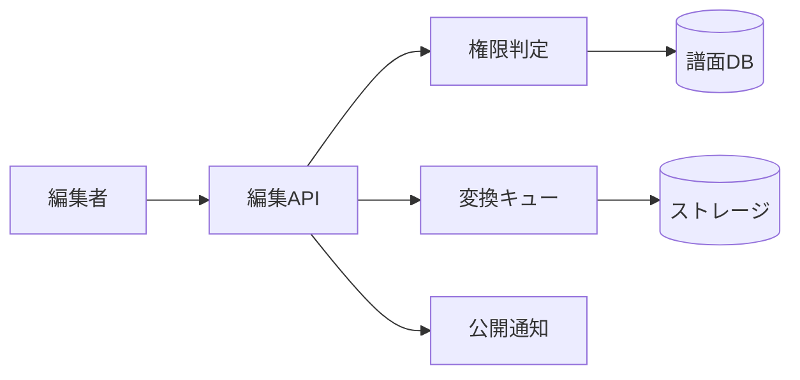

# 譜面編集 詳細設計書

## 1. 文書情報

| 項目 | 内容 |
|---|---|
| 文書名 | 譜面編集 詳細設計書 |
| 対象機能 | `PUT /api/chart` |
| 対象システム | `rp-backend/` |
| バージョン | 1.0 |
| 作成日 | 2026-10-25 |
| 対応する仕様調査書 | [backend_仕様調査書.md](../../00_基本仕様/backend_仕様調査書.md) |
| 関連設計書 | [譜面投稿](./譜面投稿.md)、[譜面削除](./譜面削除.md)、[ファイル変換](./譜面・音源・画像変換と保管.md) |

## 2. 機能概要

メタデータの部分更新、合作・タグの置換、公開状態の変更、譜面・BGM・ジャケットの差し替えを行う。投稿者、登録済み共同制作者、またはモデレーター以上が対象。権限の最終判定はバックエンドで実行する。

## 3. 機能仕様

- `data` と各ファイルは任意。本文がある場合、未指定項目は維持される。
- 通常権限は公開状態を公開以上に変更できず、合作・タグ指定もできない。
- 合作者・タグ一覧は指定された場合、既存関連を削除後、実在する ID のみ登録する。
- 公開への初回遷移時に `first_published_at` を設定し、新着通知を BackgroundTasks に追加する。
- SCHEDULED 遷移時は既存予約を削除し、予約時刻からジョブを追加する。scheduler の起動呼出しは確認できず、実行可否は要確認。
- ファイルが既存ハッシュと異なる場合だけ対応する変換完了 bit をクリアし、変換タスクを再投入する。

## 4. 詳細設計

1. JSON `data` があれば `ChartEditRequest` に parse する。
2. 利用者と chart を取得し、存在、通常以上の権限、所有者／共同制作者／モデレーター条件を検査する。
3. 指定された各メタデータを更新する。通常権限に対する制限はその前に適用される。
4. `collaborators` / `tags` が指定された場合、DB 上の既存一覧を削除し、存在確認済みの各 ID を追加する。
5. 公開状態を更新し、必要時に公開時刻・予約ジョブ・通知フラグを調整する。
6. 送信された各ファイルを読み込み、種類別サイズ上限を検査する。従来 hash と比較して差分があるもののみ再処理対象にする。
7. DB commit 後、対象 task を enqueue する。初回公開通知は BackgroundTasks に登録する。

## 5. データフロー図

## 6. 入出力・データ設計

| 入力 | 型・制約 | 動作 |
|---|---|---|
| `chart_id` | query string | 対象譜面 |
| `data` | optional JSON | title/composer/vocal/displayName 最大50、description 最大200、rating 0〜50等 |
| `chart_file` | optional binary | 最大60 MiB |
| `bgm_file` | optional binary | 最大30 MiB |
| `jacket_file` | optional binary | 最大5 MiB |
| Response | 空応答 | 成功時 |

根拠: [edit_chart.py](../../../rp-backend/router/web/chart/edit_chart.py)、[requests.py](../../../rp-backend/schemas/requests.py)、[scheduler.py](../../../rp-backend/utils/scheduler.py)

## 7. エラー・例外・制約

- 本文がない状態で一部権限・投稿数の判定が `body` を参照する分岐があり、ファイルのみ更新を含む特定条件で例外となる可能性がある。明示的な扱いは要確認。
- タスク再投入は DB commit 後であり、enqueue 失敗時のロールバックはない。
- 予約公開の job 登録はあるが、scheduler 起動はコード上では確認できない。

## 8. 設定・外部依存

PostgreSQL、Celery/Redis、S3、公開通知 Webhook、scheduler に依存する。

## 9. テスト観点

- 所有者・共同制作者・moderator 権限境界、通常権限での公開／合作／タグ拒否。
- 各変更フィールドの未指定保持、合作・タグ置換、無効 ID の除外。
- 同一ファイルは変換しない、差し替えは該当完了 bit を解除しタスクを再投入。
- 初回公開、非公開化、予約遷移、予約削除とジョブ登録。
- ファイルのみ／本文なしの更新境界。自動テストは確認できない。

## 10. バージョン履歴

| バージョン | 日付 | 変更内容 |
|---|---|---|
| 1.0 | 2026-10-25 | 初版作成 |
