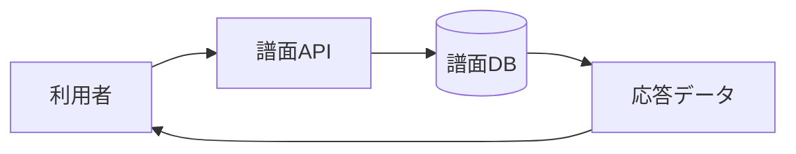

# 譜面詳細・自分の譜面 詳細設計書

## 1. 文書情報

| 項目 | 内容 |
|---|---|
| 文書名 | 譜面詳細・自分の譜面 詳細設計書 |
| 対象機能 | 譜面詳細取得、本人の投稿・合作譜面一覧 |
| 対象システム | `rp-backend/` |
| バージョン | 1.0 |
| 作成日 | 2026-10-25 |
| 対応する仕様調査書 | [backend_仕様調査書.md](../../00_基本仕様/backend_仕様調査書.md) |
| 関連設計書 | [譜面検索](./譜面検索.md)、[ファイル変換](./譜面・音源・画像変換と保管.md) |

## 2. 機能概要

`GET /api/chart?chart_id=...` は未削除の譜面の詳細を返し、`GET /api/chart/my` はログイン利用者が投稿または合作参加した譜面をページングして返す。詳細 API は公開状態を条件に含めないため、ID を知る利用者は非公開譜面の詳細メタデータと変換済みデータ locator を取得できる。原本譜面 locator は原本公開設定が公開の場合のみ応答に含む。

## 3. 機能仕様

- 詳細 API はイベント・タグ等を eager load するが、現行レスポンス生成では `events=[]`, `tags=[]` を返す。
- 変換済み LevelData、BGM、プレビューは hash が存在する場合に locator を含める。
- `GET /api/chart/my` は本人作成分と本人がコラボレーターとして登録された譜面を対象とし、未削除のみを返す。公開状態による絞り込みはない。
- 自分の譜面一覧は `updated_at desc`、limit 最大40。カーソル比較には `updated_at` と ID の双方を使用するが、SQL order_by に ID の副順序は指定されていない。

## 4. 詳細設計

### 詳細取得

1. `chart_id` と `is_deleted=false` で譜面を検索し、関連するタグ、イベント、作者、コラボレーターを読み込む。
2. 見つからない場合は `ChartNotFound`。
3. 詳細 schema にメタデータ、作者、共同制作者、公開状態、変換状態を詰める。
4. 原本 locator は公開設定が `PUBLIC` の場合のみ設定し、LevelData/BGM/preview は各 hash が null でない場合のみ設定する。

### 自分の譜面一覧

1. 認証ユーザーを取得し、存在しない場合は `UserNotFound`。
2. 件数上限を1〜40に制限し、作者 ID または collaborator relation で抽出する。
3. 指定 cursor があれば更新日時および ID の次ページ条件を追加する。
4. 一覧 schema へ変換し、結果数が limit と等しい場合のみ cursor を設定する。

## 5. データフロー図

## 6. 入出力・データ設計

| API | 入力 | 主な出力 |
|---|---|---|
| `GET /api/chart` | `chart_id` | 譜面情報、作者、collaborator、公開状態、locator、変換状態 |
| `GET /api/chart/my` | Cookie、任意 `cursor`, `limit` | `charts`, `next`, `cursor` |

根拠: [get_chart.py](../../../rp-backend/router/web/chart/get_chart.py)、[responses.py](../../../rp-backend/schemas/responses.py)

## 7. エラー・例外・制約

- 詳細は論理削除済みまたは未存在で `ChartNotFound`。
- 非公開譜面の詳細取得を拒否する公開チェックは実装されていない。原本 locator の秘匿だけ別途適用する。
- 自分の譜面一覧の認証・DB エラーは共通依存・例外処理に従う。エラー schema は本 endpoint 内で個別定義されない。

## 8. 設定・外部依存

PostgreSQL、認証 Cookie、SonolusResourceLocator 型に依存する。ファイル本体の保存先は [ファイル変換](./譜面・音源・画像変換と保管.md) を参照。

## 9. テスト観点

- 未存在／削除済み／非公開／公開譜面の詳細応答。
- 原本公開状態による locator の有無、処理途中の locator 欠落。
- 作者・協作者の抽出、cursor 境界、limit 1・40・範囲外。
- 自動テストは確認できない。

## 10. バージョン履歴

| バージョン | 日付 | 変更内容 |
|---|---|---|
| 1.0 | 2026-10-25 | 初版作成 |
