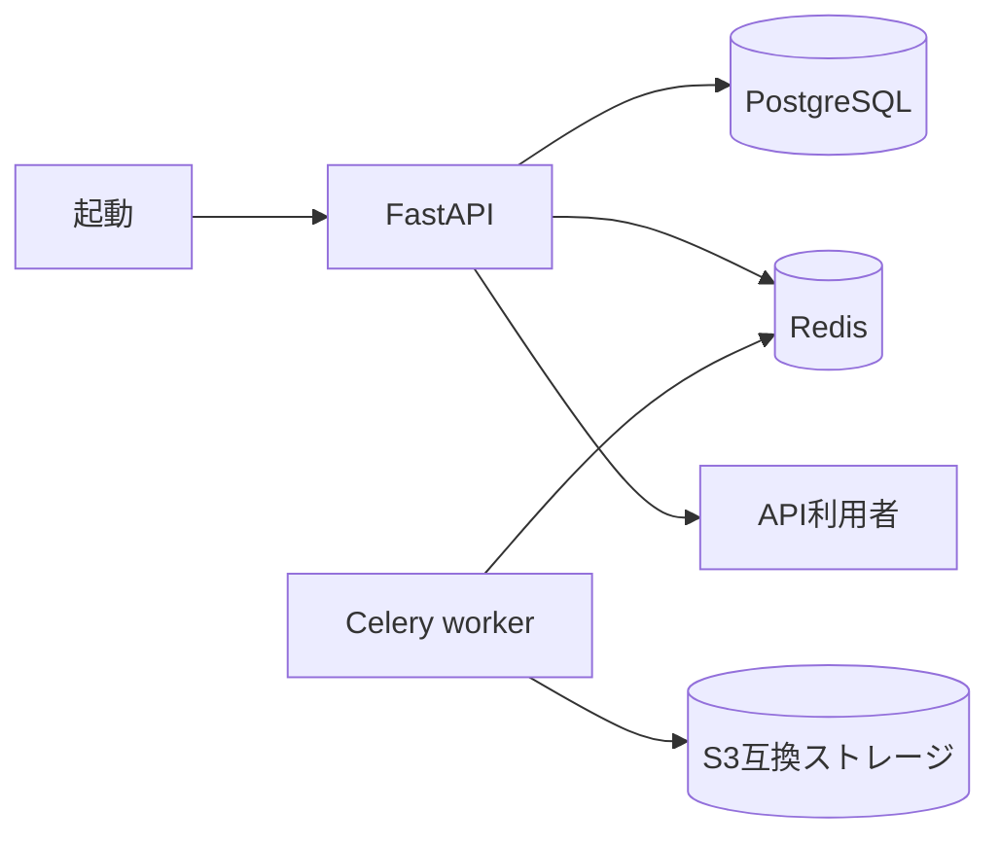

# バックエンド起動・データ保管 詳細設計書

## 1. 文書情報

| 項目 | 内容 |
|---|---|
| 文書名 | バックエンド起動・データ保管 詳細設計書 |
| 対象機能 | FastAPI 起動、Celery と保管先の接続 |
| 対象システム | `rp-backend/` |
| バージョン | 1.1 |
| 作成日 | 2026-10-25 |
| 対応する仕様調査書 | [backend_仕様調査書.md](../../00_基本仕様/backend_仕様調査書.md) |
| 関連設計書 | [ファイル変換](./譜面・音源・画像変換と保管.md)、[Sonolus API](./SonolusサーバーAPI.md) |

## 2. 機能概要

FastAPI アプリケーションを起動し、PostgreSQL、Celery、Redis、S3 互換ストレージと連携する。現行の lifespan では DB table 初期化関数を呼び出さない。譜面等の変換タスクは Redis を Celery の broker/backend として処理し、バイナリデータは S3 互換ストレージに保存する。起動処理は `rp-backend/main.py`、DB 接続は `rp-backend/db/session.py`、タスク登録は `rp-backend/celery_app.py` が担当する。

設定値や外部サービスの実稼働状態はコードからは判定できない。環境変数の実値は本設計書に記載しない。

## 3. 機能仕様

- `init_db_model()` の import は残るが、lifespan 内の呼び出しはコメントアウトされており、アプリケーション起動時に SQLAlchemy metadata のテーブルを作成しない。
- `USE_UVICORN == "1"` の場合に限り、Sonolus アイテム資源をロードする。
- `icon.ico` を読み込み、`GET /favicon.ico` でバイナリ応答する。`GET /` は空文字列を返す。
- FastAPI の標準ドキュメント URL は無効化されている。
- 非同期 API 用と同期 Celery タスク用に別々の SQLAlchemy engine/session maker を生成する。

## 4. 詳細設計

1. FastAPI lifespan 開始時に `init_db_model()` は呼び出さない。`db/session.py` にある関数自体は `Base.metadata.create_all` を行うが、アプリケーション起動経路からは実行されない。
2. `USE_UVICORN` の値を検査し、条件成立時のみ `setup_item_resource()` を await する。
3. 作業ディレクトリの `icon.ico` を読み込んでプロセス内 `ICON_DATA` に格納する。
4. リクエストルーターを登録し、Web API は `/api` prefix、Sonolus API はルート直下で提供する。
5. Celery は `REDIS_URL` を broker/backend として構成し、`utils.convert_tasks` をタスクモジュールとしてロードする。worker 初期化シグナルでは Sonolus 資源をロードする。
6. DB セッション依存関係はリクエスト終了時に close する。同期タスク用 session も各タスク内で close する。

## 5. データフロー図

## 6. 入出力・データ設計

| 項目 | 形式 | 用途 | 根拠 |
|---|---|---|---|
| `POSTGRES_USER`, `POSTGRES_PASSWORD`, `POSTGRES_DB` | 環境変数 | PostgreSQL URL 組み立て | [db/session.py](../../../rp-backend/db/session.py) |
| `REDIS_URL` | 設定値 | Celery broker/backend | [celery_app.py](../../../rp-backend/celery_app.py) |
| `USE_UVICORN` | 設定値 | 起動時 Sonolus 資源ロード条件 | [main.py](../../../rp-backend/main.py) |
| `icon.ico` | ファイル bytes | favicon 応答内容 | [main.py](../../../rp-backend/main.py) |

## 7. エラー・例外・制約

- アイコン読込、Sonolus 資源読込の起動時例外を個別に変換する処理は `main.py` では確認できない。DB 初期化処理は起動時に実行されない。
- DB 接続 URL はコード上で `postgres:5432` を使用する。接続先の実環境値は要確認。
- `GET /` の成功応答は空本文であり、ヘルスチェック用途としての保証はコード上では確認できない。

## 8. 設定・外部依存

PostgreSQL、Redis、S3 互換ストレージ、Celery worker、Sonolus 資源ファイルに依存する。必要な設定名は [const/env.py](../../../rp-backend/const/env.py) に定義される。秘密値・実値は記載しない。

## 9. テスト観点

- lifespan から `init_db_model()` が呼び出されないこと、および `USE_UVICORN` による資源ロード分岐。
- `/` の空文字列応答、`/favicon.ico` の応答。
- DB や Redis が利用不能な場合の起動結果。自動テストの有無は対象コードから確認できない。

## 10. バージョン履歴

| バージョン | 日付 | 変更内容 |
|---|---|---|
| 1.0 | 2026-10-25 | 初版作成 |
| 1.1 | 2026-10-25 | 起動時のDB table初期化が無効化された現行動作を反映。 |
