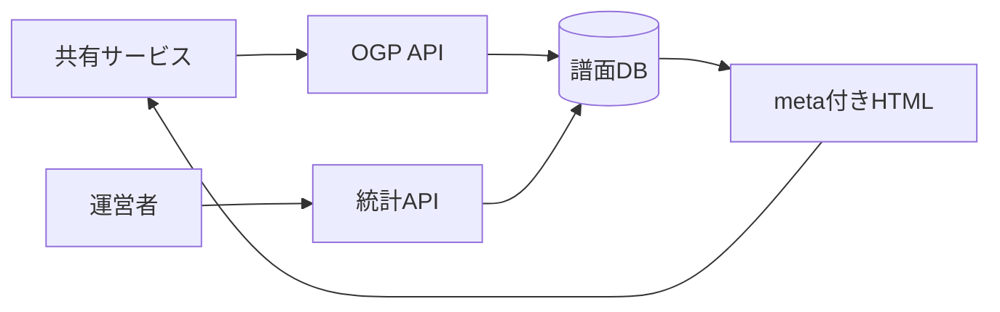

# 運営情報・共有用 OGP 詳細設計書

## 1. 文書情報

| 項目 | 内容 |
|---|---|
| 文書名 | 運営情報・共有用 OGP 詳細設計書 |
| 対象機能 | サーバー譜面統計、トップ・譜面共有用 OGP |
| 対象システム | `rp-backend/` |
| バージョン | 1.0 |
| 作成日 | 2026-10-25 |
| 対応する仕様調査書 | [backend_仕様調査書.md](../../00_基本仕様/backend_仕様調査書.md) |
| 関連設計書 | [お知らせ管理](./お知らせ管理.md)、[譜面検索](./譜面検索.md) |

## 2. 機能概要

`GET /api/server/info` は moderator 以上に譜面件数を返す。`GET /api/ogp` と `/api/ogp/chart/{chart_id}` はリンク共有 bot 向けの HTML meta を生成する。

## 3. 機能仕様

- server info は公開、非公開（publish status が PUBLIC 未満）、論理削除の件数を返す。
- OGP top はサイト名、固定タイトル・説明、icon image URL を返す。
- chart OGP は未削除の譜面を検索し、タイトル・作曲者・ボーカル、level・説明・genre・tag、jacket URL、author handle を meta に用いる。
- chart 不在時は「見つからない」説明を含む top image を返す。
- HTML text attribute 値は `html.escape` を通して出力される。

## 4. 詳細設計

1. server info は認証ユーザーを取得し、MODERATOR 未満を拒否する。
2. Chart table に対して公開・非公開・削除済みの3 count query を実行し、response schema に格納する。
3. OGP top は `render_ogp_page` に固定値を渡す。
4. OGP chart は `is_deleted=false` と chart ID で検索し、tag/author を eager load する。
5. 不在時は not found description を用いた HTML を返す。存在時は genre enum から表示名/color を取得し、空でないタイトル要素を結合して title とする。
6. `render_ogp_page` は HTML title と Open Graph/Twitter meta を生成し、任意 theme color を追加する。

## 5. データフロー図

## 6. 入出力・データ設計

| API | 入力 | 応答 |
|---|---|---|
| `GET /api/server/info` | 認証 Cookie | `chart.publicCount`, `privateCount`, `deleteCount` |
| `GET /api/ogp` | なし | HTMLResponse |
| `GET /api/ogp/chart/{chart_id}` | path `chart_id` | HTMLResponse |

根拠: [server_info/chart.py](../../../rp-backend/router/web/server_info/chart.py)、[ogp.py](../../../rp-backend/router/web/ogp.py)

## 7. エラー・例外・制約

- server info は user 不在または moderator 未満で拒否される。
- OGP chart は公開 status を条件にせず、未削除であれば非公開 chart も meta 生成対象になり得る。
- 譜面不存在時は HTTP not found ではなく fallback HTML を返す。
- HTML escaping を行うが、image URL の到達性・絶対 URL validity は検証されない。

## 8. 設定・外部依存

PostgreSQL、HOST_URL、SERVICE_NAME、genre enum に依存する。トップ reverse proxy による bot 向け振り分けは対象 router 外。

## 9. テスト観点

- 統計の分類境界と moderator 権限。
- OGP top/chart 存在/不存在、説明値・日本語・特殊文字の HTML escape。
- 非公開譜面を含む生成条件。
- 自動テストは確認できない。

## 10. バージョン履歴

| バージョン | 日付 | 変更内容 |
|---|---|---|
| 1.0 | 2026-10-25 | 初版作成 |
