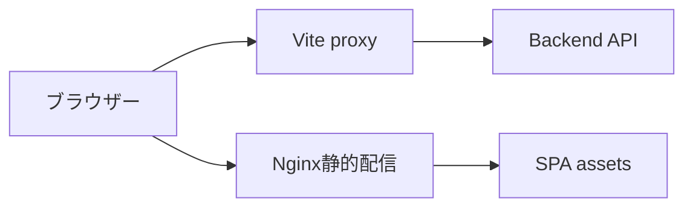

# API 接続・配信構成 詳細設計書

## 1. 文書情報

| 項目 | 内容 |
|---|---|
| 文書名 | API 接続・配信構成 詳細設計書 |
| 対象機能 | API URL 解決、Cookie request、開発 proxy、SPA 静的配信 |
| 対象システム | `rp-frontend/` |
| バージョン | 1.0 |
| 作成日 | 2026-10-25 |
| 対応する仕様調査書 | [frontend_仕様調査書.md](../../00_基本仕様/frontend_仕様調査書.md) |
| 関連設計書 | [認証・セッション](./ログイン・セッション画面.md) |

## 2. 機能概要

API helper が VITE_API_BASE または同一 origin へ request を送り、開発時は Vite proxy が `/api` と `/sonolus` を backend に転送する。本番 frontend container は静的 SPA を配信し、API転送は上位 reverse proxy に委ねる。

## 3. 機能仕様

- API base は `import.meta.env.VITE_API_BASE ?? ""`。
- cookie-auth requests は credentials include。public calls も helper により同一の fetch 機構を使用する場合がある。
- 開発 proxy target は `VITE_PROXY_TARGET`、未設定時 `http://localhost:5001`。
- Vite server/preview は host true、port 5000、strictPort。
- Nginx は unknown path を index.html に fallback、`/assets/` は1年 immutable cache。
- Nginx frontend config 内に API/Sonolus proxy はない。

## 4. 詳細設計

1. API helper は env base を prefix とし、query ID は URL encode する。
2. cookie-auth helper `authFetch` は credentials include と401 refresh/retry を担当する。
3. Vite dev server は `/api`, `/sonolus` を target に `changeOrigin` で proxy する。
4. Production Docker build は Vite build output を nginx html root に置く。Nginx は file path を試し、存在しない route は `index.html` へ fallback する。
5. 本番 API routing は top-level reverse proxy の担当であり、frontend container 内だけから詳細な接続先は確認できない。

## 5. データフロー図

## 6. 入出力・データ設計

| 設定・path | 挙動 |
|---|---|
| `VITE_API_BASE` | API base URL、未設定は空文字 |
| `VITE_PROXY_TARGET` | 開発 proxy destination、未設定は localhost:5001 |
| `/api`, `/sonolus` | 開発 proxy routes |
| `/assets/` | 本番長期 immutable cache |
| その他 route | `index.html` fallback |

根拠: [api.ts](../../../rp-frontend/src/lib/api.ts)、[http.ts](../../../rp-frontend/src/lib/http.ts)、[vite.config.ts](../../../rp-frontend/vite.config.ts)、[nginx.conf](../../../rp-frontend/nginx.conf)、[package.json](../../../rp-frontend/package.json)

## 7. エラー・例外・制約

- API helper は non-OK status を Error に変換する。network error は fetch rejection が呼出元に伝播する。
- 本番 reverse proxy/domain/TLS 設定はこの対象フォルダだけでは確認できない。
- 環境変数の実値は環境ごとに異なり、本書では記載しない。

## 8. 設定・外部依存

Vite、React build、Nginx、backend API、上位 reverse proxy に依存する。

## 9. テスト観点

- API base 未設定/設定済み、開発 proxy target 既定値/override。
- `/api`・`/sonolus` proxy、SPA deep link fallback、assets cache header。
- npm scripts は dev/build/lint/preview。自動テスト script は確認できない。

## 10. バージョン履歴

| バージョン | 日付 | 変更内容 |
|---|---|---|
| 1.0 | 2026-10-25 | 初版作成 |
