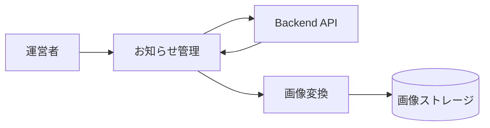

# お知らせ管理画面 詳細設計書

## 1. 文書情報

| 項目 | 内容 |
|---|---|
| 文書名 | お知らせ管理画面 詳細設計書 |
| 対象機能 | お知らせ一覧、作成、編集、削除 |
| 対象システム | `rp-frontend/` |
| バージョン | 1.0 |
| 作成日 | 2026-10-25 |
| 対応する仕様調査書 | [frontend_仕様調査書.md](../../00_基本仕様/frontend_仕様調査書.md) |
| 関連設計書 | [backend お知らせ管理](../backend/お知らせ管理.md)、[画面ルーティング](./画面ルーティング・ホーム.md) |

## 2. 機能概要

moderator 以上向けのお知らせ管理 UI。お知らせ一覧から作成画面・編集画面へ移動し、確認 dialog を介して削除する。route permission gate は App 側で実施する。

## 3. 機能仕様

- 一覧は GET API で announcement をロードし、loading skeleton、error、empty、list を切り替える。
- 作成は title/subtitle/displayName/description と thumbnail/banner 必須。text は空白 trim 後に必須判定。
- 編集は GET list から post ID を検索して初期化し、画像差し替えは任意。
- delete は確認 dialog を表示し、成功時一覧から該当行を除去。失敗時は dialog 内にエラー表示。
- API 成功後の route は一覧画面に戻る。

## 4. 詳細設計

1. `AnnouncementList` は mount 時 fetch を行い、unmount 時 AbortController を abort。
2. `SubmitAnnouncement` は必須文字列と2ファイルを検証し、trim した JSON `data` と file を multipart POST する。
3. `EditAnnouncement` は announcement list を取得し、指定 id を見つけられなければ load error。見つかればフォームと現行 image URL を設定する。
4. 保存時は必須項目を検証し、JSON data と optional file を multipart PUT。
5. 削除は confirm state の確認後 API DELETE。成功・失敗を画面に反映する。

## 5. データフロー図

## 6. 入出力・データ設計

| 操作 | payload |
|---|---|
| Create | `title`, `subtitle`, `displayName`, `description`, thumbnail file, banner file |
| Read | `GET /api/announce` |
| Update | `PUT /api/announce?post_id=...`、JSON data、optional images |
| Delete | `DELETE /api/announce?post_id=...` |

根拠: [AnnouncementList.tsx](../../../rp-frontend/src/components/AnnouncementList.tsx)、[SubmitAnnouncement.tsx](../../../rp-frontend/src/components/SubmitAnnouncement.tsx)、[EditAnnouncement.tsx](../../../rp-frontend/src/components/EditAnnouncement.tsx)、[api.ts](../../../rp-frontend/src/lib/api.ts)

## 7. エラー・例外・制約

- API failure は各画面の error state に表示する。
- frontend は空白文字のみの値を拒否するが、backend schema の長さ制約は確認できない。
- GET はホーム slider からも使用され、backend endpoint 自体に auth dependency はない。

## 8. 設定・外部依存

Backend announcements API、authFetch、FileDropField、画像変換 task に依存する。

## 9. テスト観点

- loading/error/empty/list、編集対象不在。
- 必須入力・画像欠落・更新時の画像省略。
- delete confirm/cancel/success/failure。
- API 送信内容と moderator gate。
- 自動テスト実行スクリプトは確認できない。

## 10. バージョン履歴

| バージョン | 日付 | 変更内容 |
|---|---|---|
| 1.0 | 2026-10-25 | 初版作成 |
