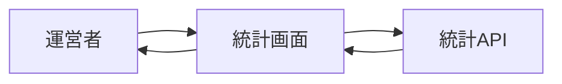

# サーバー統計画面 詳細設計書

## 1. 文書情報

| 項目 | 内容 |
|---|---|
| 文書名 | サーバー統計画面 詳細設計書 |
| 対象機能 | 譜面件数統計の取得・表示 |
| 対象システム | `rp-frontend/` |
| バージョン | 1.0 |
| 作成日 | 2026-10-25 |
| 対応する仕様調査書 | [frontend_仕様調査書.md](../../00_基本仕様/frontend_仕様調査書.md) |
| 関連設計書 | [backend 運営情報・OGP](../backend/運営情報・共有用OGP.md) |

## 2. 機能概要

運営者に公開・非公開・削除済み譜面数を表示する。route は moderator 以上に制限される。

## 3. 機能仕様

- mount 時に `/api/server/info` を一度取得する。
- データ未到着時は4件の skeleton を表示する。
- API error は画面上に表示する。
- 総譜面数は `publicCount + privateCount + deleteCount` でフロント側計算する。

## 4. 詳細設計

1. `ServerInfo` mount 時に AbortController を作成し、`fetchServerInfo` を呼び出す。
2. 成功時に info state を保存、失敗時は AbortError を除き message を保存。
3. chart counts を4表示項目へ変換し、ロケール形式の数値として描画する。
4. unmount 時に request を abort する。

## 5. データフロー図

## 6. 入出力・データ設計

| 入力 | 応答 |
|---|---|
| auth cookie | `GET /api/server/info` |
| response | `chart.publicCount`, `privateCount`, `deleteCount` |
| 表示計算 | 総数 = 3分類の合計 |

根拠: [ServerInfo.tsx](../../../rp-frontend/src/components/ServerInfo.tsx)、[api.ts](../../../rp-frontend/src/lib/api.ts)

## 7. エラー・例外・制約

- 認可エラーを含む非成功応答は API helper の error detail に基づき表示される。
- UI には自動再試行ボタンがなく、画面再表示が再取得の契機となる。

## 8. 設定・外部依存

Backend server info API、AuthProvider、Number locale formatting に依存する。

## 9. テスト観点

- loading、成功、API error、unmount abort。
- total の合算と各数値表示。
- route permission gate。
- 自動テスト実行スクリプトは確認できない。

## 10. バージョン履歴

| バージョン | 日付 | 変更内容 |
|---|---|---|
| 1.0 | 2026-10-25 | 初版作成 |
