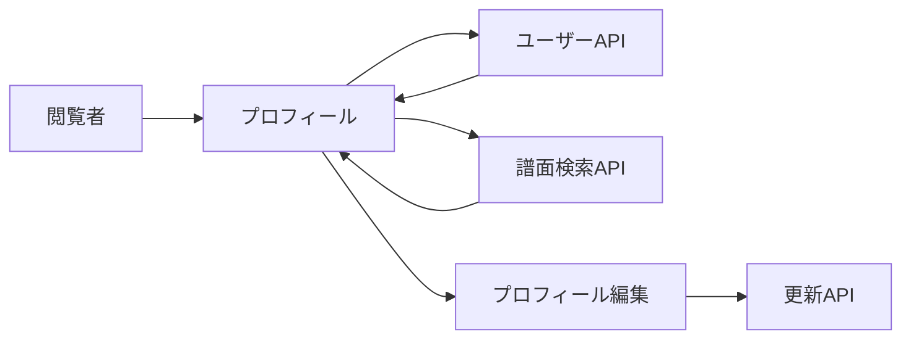

# プロフィール・自分の譜面 詳細設計書

## 1. 文書情報

| 項目 | 内容 |
|---|---|
| 文書名 | プロフィール・自分の譜面 詳細設計書 |
| 対象機能 | 公開プロフィール、公開譜面、自分の非公開譜面、プロフィール編集 |
| 対象システム | `rp-frontend/` |
| バージョン | 1.0 |
| 作成日 | 2026-10-25 |
| 対応する仕様調査書 | [frontend_仕様調査書.md](../../00_基本仕様/frontend_仕様調査書.md) |
| 関連設計書 | [ユーザー情報 backend](../backend/ユーザー情報・プロフィール管理.md)、[譜面検索画面](./譜面検索画面.md) |

## 2. 機能概要

ユーザー詳細、公開譜面、本人の非公開譜面を表示し、本人にはプロフィール編集操作を提供する。専用 `/mine` 画面では本人の作成譜面およびコラボ参加譜面を表示する。

## 3. 機能仕様

- profile API から名前、自己紹介、icon、Discord/Sonolus 表示名等を取得する。
- own profile は R18 を含む検索条件で公開譜面を取得し、別途 `/api/chart/my` で非公開譜面一覧を得る。
- 他者 profile に本人向け非公開一覧を表示しない。
- 編集画面は自己編集時 context data を初期値に使い、他ユーザー編集時は対象を fetch する。
- 編集フォームは name 必須・最大定数長、profile 最大定数長。アイコンは選択直後 object URL preview、送信後自己 profile は refresh。

## 4. 詳細設計

1. UserProfile は userId ごとに API fetch し、ID が一致する response だけを表示。遷移時の stale data を loading として扱う。
2. `isOwner` を current user と route user ID から求める。
3. 公開譜面は `useChartSearch` で userIds 指定。本人の場合のみ r18=true。
4. 本人の時だけ `PrivateCharts` を表示し、`useMyCharts` の結果から PUBLIC 以外を抽出する。
5. EditProfile は target を読み込み、name/profile/permission を form に反映。permission 欄は他者かつ moderator が低権限対象を編集する場合のみ出る。
6. 保存時に multipart API を呼び、本人なら auth context を refresh して callback を実行する。

## 5. データフロー図

## 6. 入出力・データ設計

| API | 入力 | 用途 |
|---|---|---|
| `GET /api/user` | `user_id` | プロフィール |
| `GET /api/chart/search` | `user_ids`, R18/新着条件 | 公開譜面 |
| `GET /api/chart/my` | Cookie, cursor | 投稿・合作譜面 |
| `PUT /api/user` | `target_user_id`, JSON data, optional icon | プロフィール・画像更新 |

根拠: [UserProfile.tsx](../../../rp-frontend/src/components/UserProfile.tsx)、[MyCharts.tsx](../../../rp-frontend/src/components/MyCharts.tsx)、[EditProfile.tsx](../../../rp-frontend/src/components/EditProfile.tsx)、[api.ts](../../../rp-frontend/src/lib/api.ts)

## 7. エラー・例外・制約

- 読込失敗は画面上に error text、非公開譜面の取得は認証済み API に依存する。
- icon は client preview だけで upload 完了とは扱わない。backend image task の完了通知は frontend にない。
- 権限欄の表示条件は client-side、server が最終認可する。

## 8. 設定・外部依存

Backend user/chart API、AuthContext、object URL、file drop UI に依存する。

## 9. テスト観点

- 他者/本人 profile、R18条件、private list 表示有無。
- loading/error/stale route ID。
- name/profile validation、permission control、icon preview cleanup、save refresh。
- 自動テスト実行スクリプトは確認できない。

## 10. バージョン履歴

| バージョン | 日付 | 変更内容 |
|---|---|---|
| 1.0 | 2026-10-25 | 初版作成 |
