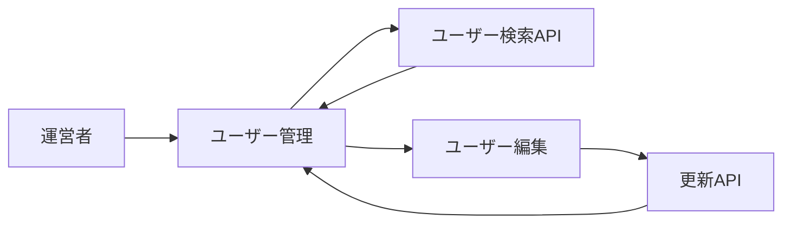

# ユーザー運営管理 詳細設計書

## 1. 文書情報

| 項目 | 内容 |
|---|---|
| 文書名 | ユーザー運営管理 詳細設計書 |
| 対象機能 | ユーザー検索・他ユーザー編集 |
| 対象システム | `rp-frontend/` |
| バージョン | 1.0 |
| 作成日 | 2026-10-25 |
| 対応する仕様調査書 | [frontend_仕様調査書.md](../../00_基本仕様/frontend_仕様調査書.md) |
| 関連設計書 | [backend ユーザー管理](../backend/ユーザー情報・プロフィール管理.md)、[画面ルーティング](./画面ルーティング・ホーム.md) |

## 2. 機能概要

MODERATOR 以上向けのユーザー検索・編集画面。検索結果から対象ユーザーの編集画面を開き、プロフィールと条件を満たす場合の permission を更新する。

## 3. 機能仕様

- `/moderation/users` と `/moderation/users/:userId` は `RequireModerator` の内側にある。
- `EditProfile` は他者情報を user detail API で読み、読み込み中・失敗状態を表示する。
- 名前とプロフィールを編集できる。アイコン file も任意指定可能。
- permission 選択は、自分以外の対象に対し、current moderator の permission より低い権限である場合に限定する。

## 4. 詳細設計

1. `ModerationUsers` の検索操作は `/api/users` を呼び、結果から user profile/editor route へ遷移する。
2. `EditProfile` は target user を取得し、form を seed する。
3. `canEditPermission` を current user と target permission の比較で計算する。自己編集時は常に false。
4. submit 時、name 必須・MAX_NAME、profile MAX_PROFILE を検証し、trim 済み name/profile を payload 化する。
5. `canEditPermission` の時だけ permission を追加し、任意 icon file と共に `PUT /api/user?target_user_id=...`。
6. API 失敗は error panel、成功時は `onSaved`。self edit の場合のみ auth profile refresh も実行。

## 5. データフロー図

## 6. 入出力・データ設計

| API | 入力 |
|---|---|
| `GET /api/users` | optional name、permission |
| `GET /api/user` | target user ID |
| `PUT /api/user` | `target_user_id`、JSON name/profile/optional permission、optional icon file |

根拠: [ModerationUsers.tsx](../../../rp-frontend/src/components/ModerationUsers.tsx)、[EditProfile.tsx](../../../rp-frontend/src/components/EditProfile.tsx)、[api.ts](../../../rp-frontend/src/lib/api.ts)、[constants.ts](../../../rp-frontend/src/lib/constants.ts)

## 7. エラー・例外・制約

- route access は client gate、backend は target/operator の権限を再検証する。
- list/detail/update failure は画面内に表示する。編集成功後の一覧更新は親 callback に委譲する。
- permission selector の非表示は server-side permission の代替ではない。

## 8. 設定・外部依存

Backend user APIs、AuthContext、FileDropField、moderator permission constant に依存する。

## 9. テスト観点

- 未ログイン・moderator未満の route redirect。
- 検索結果表示、target取得失敗。
- self/other、権限が同等以上／低位の場合の permission control。
- validation・icon file・API success/failure。
- 自動テスト実行スクリプトは確認できない。

## 10. バージョン履歴

| バージョン | 日付 | 変更内容 |
|---|---|---|
| 1.0 | 2026-10-25 | 初版作成 |
