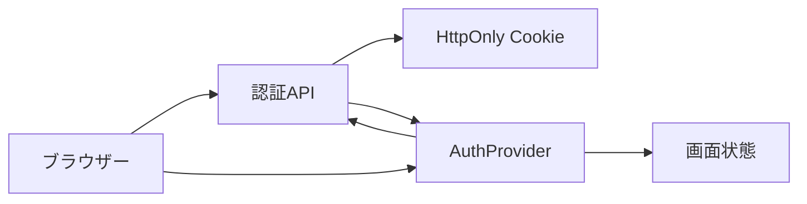

# ログイン・セッション画面 詳細設計書

## 1. 文書情報

| 項目 | 内容 |
|---|---|
| 文書名 | ログイン・セッション画面 詳細設計書 |
| 対象機能 | Discord/Sonolus login、session restore、refresh、logout |
| 対象システム | `rp-frontend/` |
| バージョン | 1.0 |
| 作成日 | 2026-10-25 |
| 対応する仕様調査書 | [frontend_仕様調査書.md](../../00_基本仕様/frontend_仕様調査書.md) |
| 関連設計書 | [バックエンド認証](../backend/認証・セッション.md)、[画面ルーティング](./画面ルーティング・ホーム.md) |

## 2. 機能概要

AuthProvider がアプリ起動時にログインユーザーを復元する。Cookie は JavaScript から読まず、fetch に `credentials: include` を指定する。LoginModal は Discord redirect または Sonolus 外部認証を提供する。

## 3. 機能仕様

- 初回 `GET /api/login` の完了まで auth loading を true にする。
- cookie-auth request が401なら `POST /api/auth/refresh` を一度試し、成功時に元 request を一度再送する。
- 再送も401なら `auth:expired` event を dispatch し、AuthProvider は user を null にする。
- Sonolus login は session start 後、2.5秒間隔で status を poll。completed 時に user refresh 後 modal を閉じる。
- logout は backend 呼出後、必ず local user state を null にする。

## 4. 詳細設計

1. AuthProvider mount 時 `fetchCurrentUser()` を呼ぶ。401 は `authFetch` が refresh/retry 後の応答で未認証として null にする。その他の例外も Provider の catch で null とする。
2. authFetch は初回 response が401以外ならそのまま返す。401 の場合 refresh endpoint を呼び、refresh 成功時に元 request を再送する。
3. 最終 response が401なら window event を通知する。利用側 API helper が必要に応じて status を Error に変換する。
4. Discord button は `/api/discord/login` へ location navigation。
5. Sonolus button は `/api/sonolus/login` を POST し、返却 URL を表示・copy 可能にする。
6. status polling は完了またはエラーで interval を停止。modal close/unmount でも停止する。
7. signOut は logout request の例外を無視してから local state を消去する。

## 5. データフロー図

## 6. 入出力・データ設計

| API | Method | body/query | 結果 |
|---|---|---|---|
| `/api/login` | GET | Cookie credentials | user detail または401 |
| `/api/auth/refresh` | POST | Cookie credentials | `res.ok` の真偽 |
| `/api/logout` | POST | Cookie credentials | Cookie 削除依頼 |
| `/api/sonolus/login` | POST | なし | `auth_id`, `auth_url` |
| `/api/auth/status` | GET | `auth_id` | 202 pending / success completed |
| `/api/discord/login` | navigation | なし | OAuth redirect |

根拠: [AuthProvider.tsx](../../../rp-frontend/src/auth/AuthProvider.tsx)、[http.ts](../../../rp-frontend/src/lib/http.ts)、[auth.ts](../../../rp-frontend/src/lib/auth.ts)、[LoginModal.tsx](../../../rp-frontend/src/components/LoginModal.tsx)

## 7. エラー・例外・制約

- 初期 user fetch の全例外は未ログインとして扱う。logout network error も無視する。
- Sonolus login start/poll failure は modal 内 error state に表示する。
- clipboard 書込失敗は捕捉されるが、リンク自体は画面に残る。
- refresh fetch 自体のネットワーク例外は `authFetch` で捕捉されず、呼出元へ reject する。

## 8. 設定・外部依存

VITE_API_BASE、Backend API、browser Cookie、Discord OAuth、Sonolus external-login、Clipboard API。

## 9. テスト観点

- 起動時 user取得、401 refresh成功/失敗、retry後401 event。
- 401以外の応答は refresh しない。
- Sonolus poll pending/completed/error、modal close時の interval cleanup。
- logout API 成功・失敗時の local state。
- 自動テスト実行スクリプトは確認できない。

## 10. バージョン履歴

| バージョン | 日付 | 変更内容 |
|---|---|---|
| 1.0 | 2026-10-25 | 初版作成 |
