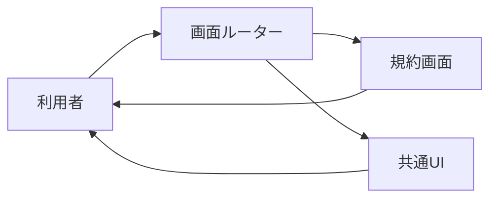

# 利用規約・共通 UI 詳細設計書

## 1. 文書情報

| 項目 | 内容 |
|---|---|
| 文書名 | 利用規約・共通 UI 詳細設計書 |
| 対象機能 | 静的利用規約、Header/Footer 等の共通表示 |
| 対象システム | `rp-frontend/` |
| バージョン | 1.0 |
| 作成日 | 2026-10-25 |
| 対応する仕様調査書 | [frontend_仕様調査書.md](../../00_基本仕様/frontend_仕様調査書.md) |
| 関連設計書 | [画面ルーティング・ホーム](./画面ルーティング・ホーム.md) |

## 2. 機能概要

`/terms` に静的利用規約を表示する。Header、Footer、SettingsLayout 等は各 route で共通のナビゲーション・外枠を構成する。

## 3. 機能仕様

- 規約本文は画面 component 内に定義され、API 取得処理はない。
- Header の操作は App の callback を介して route navigation、ログイン modal、プロフィール等へ遷移する。
- SettingsLayout は運営ページで共通の管理ナビゲーションを提供する。

## 4. 詳細設計

1. `/terms` route は認証 gate なしで `Terms` component を描画する。
2. `AppShell` は route 群の外側に Header、Footer、必要時 login modal を配置する。
3. Sonolus account 未連携ユーザーには SonolusLinkModal を表示する。
4. Header の操作は直接 API を呼ばず、AppShell の navigation callbacks を使用する。

## 5. データフロー図

## 6. 入出力・データ設計

画面 route は `/terms`。利用規約本文は静的コンテンツで、backend request/response はない。

根拠: [Terms.tsx](../../../rp-frontend/src/components/Terms.tsx)、[Header.tsx](../../../rp-frontend/src/components/Header.tsx)、[Footer.tsx](../../../rp-frontend/src/components/Footer.tsx)、[SettingsLayout.tsx](../../../rp-frontend/src/components/SettingsLayout.tsx)、[App.tsx](../../../rp-frontend/src/App.tsx)

## 7. エラー・例外・制約

規約本文を remote 更新する機能、本文取得失敗状態はコード上では確認できない。

## 8. 設定・外部依存

React Router と AppShell の callback に依存する。外部 API 依存はない。

## 9. テスト観点

- `/terms` 直接表示、unknown route からの redirect。
- Header navigation callback と認証モーダル表示。
- 自動テスト実行スクリプトは確認できない。

## 10. バージョン履歴

| バージョン | 日付 | 変更内容 |
|---|---|---|
| 1.0 | 2026-10-25 | 初版作成 |
