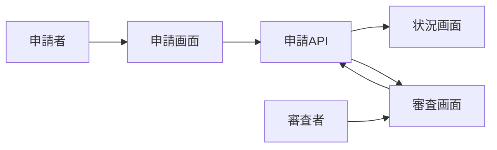

# 制作者認定申請・審査画面 詳細設計書

## 1. 文書情報

| 項目 | 内容 |
|---|---|
| 文書名 | 制作者認定申請・審査画面 詳細設計書 |
| 対象機能 | 申請一覧、申請作成、申請状況、審査待ち・判断 |
| 対象システム | `rp-frontend/` |
| バージョン | 1.0 |
| 作成日 | 2026-10-25 |
| 対応する仕様調査書 | [frontend_仕様調査書.md](../../00_基本仕様/frontend_仕様調査書.md) |
| 関連設計書 | [backend 審査](../backend/制作者認定申請・審査.md) |

## 2. 機能概要

通常権限利用者は自身の譜面を選択して申請し、申請履歴・判定を確認する。AUTHORIZED_CHARTER 以上の審査者は open request を一覧し、申請詳細から承認または却下する。

## 3. 機能仕様

- Apply route は RequireNormal gate。コラボ譜面を選択候補から除外し、選択数は1件。
- open request があれば再申請ボタンを disable し、status 画面への導線を表示。
- status 画面は loading/error/retry を持ち、stepper、承認/却下数、時系列履歴、申請譜面を表示する。
- 審査者は open request かつ未投票時にのみ判断パネルを表示。理由は任意。
- pending list は refresh 操作があり、loading/error/empty/list を切り替える。

## 4. 詳細設計

1. CharterRequests は本人の request list を取得し、`isClosed=false` があれば新規申請を無効にする。
2. Apply は `/api/chart/my` 結果から collabo chart を除き、カード選択で単一 chart ID を保持する。
3. Submit 時は選択・処理中・open request を検査して `POST /api/auth/charter/request` を呼ぶ。成功時に request status path へ遷移。
4. Pending list は `/api/auth/charter/requests/pending` をロードし、状態集計と申請者・譜面を表示する。
5. Status は request ID で detail fetch。申請者本人か、AUTHORIZED_CHARTER 以上かを state 上で判定し、reviewer かつ未投票かつ open の場合のみ ReviewPanel を表示。
6. ReviewPanel は optional reason と decision status を `POST /api/auth/charter/approval` へ送る。成功時は親から reload、失敗時は panel 内に表示。

## 5. データフロー図

## 6. 入出力・データ設計

| API | 送信・取得 |
|---|---|
| `GET /api/auth/charter/requests?target_user_id=` | 本人 request history |
| `GET /api/auth/charter/requests/pending` | 全 open request |
| `GET /api/auth/charter/request?request_id=` | detail |
| `POST /api/auth/charter/request` | multipart JSON `{chart_id}` |
| `POST /api/auth/charter/approval?request_id=` | multipart JSON `{status, reason}` |

根拠: [CharterApply.tsx](../../../rp-frontend/src/components/CharterApply.tsx)、[CharterRequests.tsx](../../../rp-frontend/src/components/CharterRequests.tsx)、[CharterPendingRequests.tsx](../../../rp-frontend/src/components/CharterPendingRequests.tsx)、[CharterStatus.tsx](../../../rp-frontend/src/components/CharterStatus.tsx)、[api.ts](../../../rp-frontend/src/lib/api.ts)

## 7. エラー・例外・制約

- API 失敗は該当画面の error 表示、retry または再送可能な状態として提示する。
- route gate と review button state は UX 制御であり、backend 認可が最終判断。
- backend は2承認で承認、2却下で却下。UI count は `constants.ts` の閾値を表示に利用する。

## 8. 設定・外部依存

Backend charter APIs、AuthContext、譜面一覧 API に依存する。

## 9. テスト観点

- 通常ユーザー/認定制作者以上の route 表示、未認証。
- collabo 譜面除外、単一選択、open request 中の申請禁止。
- request status states、approval count/reason history、既投票後の panel 非表示。
- success/error/reload。自動テスト実行スクリプトは確認できない。

## 10. バージョン履歴

| バージョン | 日付 | 変更内容 |
|---|---|---|
| 1.0 | 2026-10-25 | 初版作成 |
