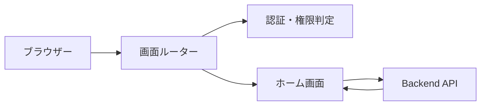

# 画面ルーティング・ホーム 詳細設計書

## 1. 文書情報

| 項目 | 内容 |
|---|---|
| 文書名 | 画面ルーティング・ホーム 詳細設計書 |
| 対象機能 | SPA ルート、画面遷移、アクセス制御、ホーム表示 |
| 対象システム | `rp-frontend/` |
| バージョン | 1.0 |
| 作成日 | 2026-10-25 |
| 対応する仕様調査書 | [frontend_仕様調査書.md](../../00_基本仕様/frontend_仕様調査書.md) |
| 関連設計書 | [譜面検索](./譜面検索画面.md)、[認証](./ログイン・セッション画面.md) |

## 2. 機能概要

React Router の SPA 画面を構成し、認証・permission に応じた route gate と共通 UI を提供する。ホームは新着譜面と pinned announcement slider を表示する。

## 3. 機能仕様

主要 route は `/`, `/search`, `/chart/:chartId`, `/chart/:chartId/edit`, `/user/:userId`, `/submit`, `/profile`, `/mine`、制作者申請、運営画面、`/terms`。未定義 path は `/` に replace redirect する。

- `RequireAuth`: 初期認証ロード中は描画なし。未ログインならホームへ redirect し、親から渡された callback でログイン modal を開く。
- `RequireNormal`: permission が正確に NORMAL でなければホームへ redirect。
- `RequireCharterReviewer`: AUTHORIZED_CHARTER 未満をホームへ redirect。
- `RequireModerator`: MODERATOR 未満をホームへ redirect。
- これらは画面遷移制御であり API 認可の代わりではない。
- Home は固定検索条件で新着20件を取得し、Slider は announcement list をロードする。
- Slider は2件以上ある場合に5秒間隔で自動送りし、hover/touch 中は停止。取得失敗または0件では非表示。

## 4. 詳細設計

1. `App` は `AuthProvider` で `AppShell` を包む。
2. pathname 変更時に `ScrollToTop` がページ先頭へ移動。
3. `AppShell` はヘッダー操作から navigate または login modal を起動し、各 path に component を割り当てる。
4. protected route は認証 loading を待って gate 判定する。
5. `/` の `HomePage` は `useChartSearch(LATEST_PARAMS)` と `Slider` を配置する。
6. Slider は announcements を取得、前後 clone を追加して loop 表示する。scroll settle を debounce し、clone 側へ到達した場合に対応する実 slide へ瞬時に戻す。

## 5. データフロー図

## 6. 入出力・データ設計

| 入力 | 処理 |
|---|---|
| pathname / route params | component 選択、ID の navigation |
| AuthContext user/loading | gate とヘッダー表示 |
| 新着条件 | `sortType=new`, `order=desc`, level 0〜50、R18除外、limit 20 |
| announcement response | slider item 列 |

根拠: [App.tsx](../../../rp-frontend/src/App.tsx)、[Slider.tsx](../../../rp-frontend/src/components/Slider.tsx)、[AuthProvider.tsx](../../../rp-frontend/src/auth/AuthProvider.tsx)

## 7. エラー・例外・制約

- Gate は client-side UX 制御のみ。API 権限は backend が再検証する。
- Slider fetch failure は catch 後に非表示状態となる。
- Home chart fetch failure は共有 chart list component のエラー表示・再試行動作に委譲する。
- 各 route は URL 状態を query string に同期しない。

## 8. 設定・外部依存

React 19、React Router、AuthProvider、Backend API に依存する。

## 9. テスト観点

- route ごとの表示、unknown route、ID 欠落時 redirect。
- ログインロード中・未ログイン・各 permission の route gate。
- slider 0/1/複数件、取得失敗、autoplay pause、loop 境界。
- 自動テスト実行スクリプトは package.json に確認できない。

## 10. バージョン履歴

| バージョン | 日付 | 変更内容 |
|---|---|---|
| 1.0 | 2026-10-25 | 初版作成 |
