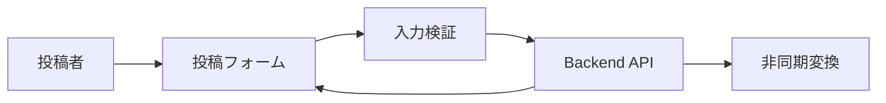

# 譜面投稿画面 詳細設計書

## 1. 文書情報

| 項目 | 内容 |
|---|---|
| 文書名 | 譜面投稿画面 詳細設計書 |
| 対象機能 | 新規譜面情報入力・ファイル選択・送信 |
| 対象システム | `rp-frontend/` |
| バージョン | 1.0 |
| 作成日 | 2026-10-25 |
| 対応する仕様調査書 | [frontend_仕様調査書.md](../../00_基本仕様/frontend_仕様調査書.md) |
| 関連設計書 | [バックエンド投稿](../backend/譜面投稿.md)、[譜面編集画面](./譜面編集・削除画面.md) |

## 2. 機能概要

認証ユーザーが譜面 metadata、譜面/BGM/ジャケットを入力し、multipart POST を行う。成功後は利用者自身のプロフィールへ遷移する。初回投稿状態は常に非公開。

## 3. 機能仕様

- 必須 text: title/composer/vocal/displayName。各50文字以内。description は200文字以内。
- rating 0〜50、collaborators 最大20、tags 最大4。
- chart/BGM/jacket file は全て必要で client file-size limit は `constants.ts` の定義値。
- `SHOW_TAGS=false` のためタグ UI は非表示だが、タグ state は payload に含まれる。
- 公開 status は常に PRIVATE、schedule は null。
- start time 初期値40秒。BGM preview editor で変更可能。
- submit 中は重複送信を防止し、入力不備と API failure を表示。

## 4. 詳細設計

1. `SubmitChart` は form initial state を作成し、props の defaultDisplayName をセットする。
2. `validate()` が必須、文字数、rating、collaborator/tag 数、3ファイル有無を確認し、問題時は先頭に scroll。
3. payload を構築し、文字列は trim、enum/boolean は数値定数に変換する。
4. `postChart` は JSON `data` と3 file を `FormData` に追加し、authFetch で `/api/chart` を POST。
5. non-OK 応答は backend detail/status を Error にし、画面上部に失敗表示。成功は `onPosted` に通知する。

## 5. データフロー図

## 6. 入出力・データ設計

| フィールド | 送信形式 | 初期値／制約 |
|---|---|---|
| title/composer/vocal/displayName | JSON string | 必須、最大50文字 |
| description | JSON string | 最大200文字 |
| genre/difficulty/rating | JSON number | rating 0〜50 |
| r18/collaborators/tags | JSON values | R18 enum、協力者20人、タグ4件 |
| publishStatus/scheduledAt | JSON number/null | PRIVATE/null 固定 |
| chartFilePublishStatus/startTime | JSON number | file公開設定、秒数 |
| chart_file/bgm_file/jacket_file | multipart File | 全必須 |

根拠: [SubmitChart.tsx](../../../rp-frontend/src/components/SubmitChart.tsx)、[api.ts](../../../rp-frontend/src/lib/api.ts)、[constants.ts](../../../rp-frontend/src/lib/constants.ts)

## 7. エラー・例外・制約

- client validation は backend schema の一部を mirror するが、server 側検証が最終判断。
- API error は message として表示。成功後遷移の実装は App に委譲される。
- file size の実際の制約値は `constants.ts` にあり、server側制限とも照合する必要がある。

## 8. 設定・外部依存

Backend `/api/chart`、AuthProvider、FileDropField、AudioPreviewEditor に依存する。

## 9. テスト観点

- 必須入力・長さ・rating・file欠落、上限境界。
- trim された JSON payload、公開 status 固定、startTime。
- submit中の多重送信抑止、成功遷移、server error 表示。
- 自動テスト実行スクリプトは確認できない。

## 10. バージョン履歴

| バージョン | 日付 | 変更内容 |
|---|---|---|
| 1.0 | 2026-10-25 | 初版作成 |
