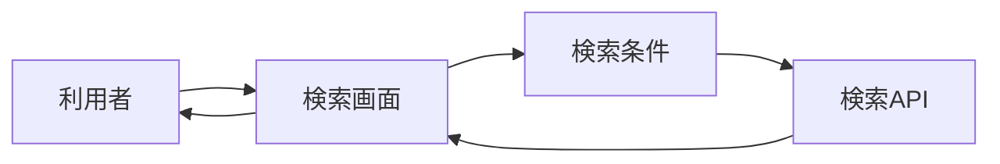

# 譜面検索画面 詳細設計書

## 1. 文書情報

| 項目 | 内容 |
|---|---|
| 文書名 | 譜面検索画面 詳細設計書 |
| 対象機能 | 検索条件入力、検索実行、結果表示・ページング |
| 対象システム | `rp-frontend/` |
| バージョン | 1.0 |
| 作成日 | 2026-10-25 |
| 対応する仕様調査書 | [frontend_仕様調査書.md](../../00_基本仕様/frontend_仕様調査書.md) |
| 関連設計書 | [画面ルーティング・ホーム](./画面ルーティング・ホーム.md)、[バックエンド検索](../backend/譜面検索.md) |

## 2. 機能概要

利用者が検索語・レベル範囲・難易度・ジャンル・R18・合作・並び順を設定し、検索 API を明示的に実行する。結果一覧は cursor による追加読み込みを行う。

## 3. 機能仕様

- フィルター入力は `draft`、検索実行時の条件は `committed`。検索ボタンまたは Enter で実行する。
- 検索中は検索ボタンと Enter 再実行を抑止する。
- sort は新着/人気、order は昇順/降順。
- 最低・最高レベルは相互に矛盾しないよう UI 側で補正する。
- 結果なし、初回 loading、エラー、追加 loading を個別表示し、初回エラーには再試行操作を出す。

## 4. 詳細設計

1. 画面初期値は新着降順、0〜50、R18 false、合作 false、20件。
2. Toolbar と FilterSidebar の変更は draft のみを書き換える。
3. 検索実行時に draft のコピーを committed に格納する。新しい object reference により同一条件でも再取得する。
4. `useChartSearch` は `searchCharts` を `usePaginatedCharts` に渡す。fetchPage が変化すると1ページ目を再取得する。
5. `searchCharts` は query parameter を組み立て、`GET /api/chart/search` を呼ぶ。失敗 status は例外化する。
6. 「もっと見る」は受け取った cursor を使って追加取得し、成功時は一覧を append、失敗時は既存結果を維持しエラーを表示する。

## 5. データフロー図

## 6. 入出力・データ設計

| 入力・query | 現行実装 |
|---|---|
| `keywords`, `min_rating`, `max_rating`, `r18`, `collabo`, `sort_type`, `order`, `limit`, `cursor` | API request に設定 |
| `difficulty_ids`, `genre_ids`, `user_ids` | 繰り返し query parameter として設定 |
| `tag_ids`, `event_ids` | type/backend には存在するが現行 `searchCharts` は送信しない |
| 応答 | `charts`, `next`, `cursor` |

根拠: [SearchPage.tsx](../../../rp-frontend/src/components/SearchPage.tsx)、[FilterSidebar.tsx](../../../rp-frontend/src/components/FilterSidebar.tsx)、[usePaginatedCharts.ts](../../../rp-frontend/src/hooks/usePaginatedCharts.ts)、[api.ts](../../../rp-frontend/src/lib/api.ts)

## 7. エラー・例外・制約

- API が非成功 status を返すと例外になり、一覧 state の `error` に反映される。
- 1ページ目エラーで一覧が空なら全面エラーと retry、追加ページ失敗では既存一覧を保持しエラー文を追加表示する。
- API client は tag/event filter を query に送信しない。仕様調査書記載の全条件が画面から現在利用可能とは限らない。

## 8. 設定・外部依存

VITE_API_BASE（未設定時は同一 origin）、Backend chart search API に依存する。

## 9. テスト観点

- draft のみ変更されること、検索ボタン/Enter、検索中の多重送信防止。
- min/max 同期、sort/order切替、複数 filter 選択。
- query parameter 名・繰り返し値、cursor append、AbortSignal cleanup。
- empty/error/retry/loading-more UI。
- 自動テスト実行スクリプトは確認できない。

## 10. バージョン履歴

| バージョン | 日付 | 変更内容 |
|---|---|---|
| 1.0 | 2026-10-25 | 初版作成 |
