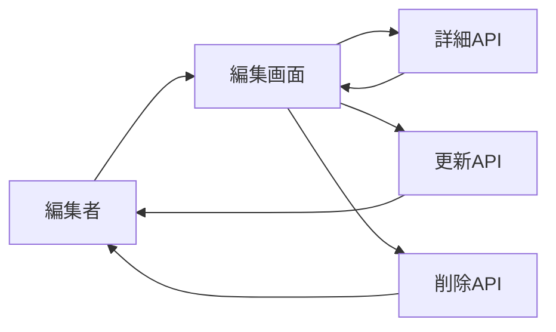

# 譜面編集・削除画面 詳細設計書

## 1. 文書情報

| 項目 | 内容 |
|---|---|
| 文書名 | 譜面編集・削除画面 詳細設計書 |
| 対象機能 | 譜面情報編集、ファイル差し替え、論理削除要求 |
| 対象システム | `rp-frontend/` |
| バージョン | 1.0 |
| 作成日 | 2026-10-25 |
| 対応する仕様調査書 | [frontend_仕様調査書.md](../../00_基本仕様/frontend_仕様調査書.md) |
| 関連設計書 | [バックエンド編集](../backend/譜面編集.md)、[バックエンド削除](../backend/譜面削除.md) |

## 2. 機能概要

詳細 API から既存値を読み込み、metadata の更新とファイル差し替えを任意で送る。所有者または administrator に削除 UI を表示する。最終アクセス判定は backend が行う。

## 3. 機能仕様

- detail load 中は skeleton、失敗時は error message。
- PUBLIC 以外の status は form 上 PRIVATE に正規化される。UI の publish choice は PRIVATE/PUBLIC のみ。
- tags は編集 UI がなく、payload に含めない。
- startTime は詳細 API から返らないため40秒を初期値とし、BGM file 差替時だけ payload に含める。
- chart/BGM/jacket は個別に optional 差し替え。client validation は metadata を確認する。
- delete は確認 dialog 後に API を呼び、失敗 message を表示。

## 4. 詳細設計

1. chart ID で詳細を取得し `fromDetail` で form state を初期化する。AbortController で画面切替時の取得を止める。
2. 保存時に必須/文字数/rating/collaborator 上限を検証する。
3. 更新 JSON を構築し、送信 file が選択された種類だけ `FormData` に追加する。tags は意図的に除外。
4. BGM を差し替える場合だけ `startTime` を設定し、`PUT /api/chart?chart_id=...` を呼ぶ。
5. success は `onSaved`、failure は form error にする。
6. delete confirmation 後 `DELETE /api/chart?chart_id=...` を呼ぶ。成功は親 route callback、失敗は dialog を閉じて delete error を示す。

## 5. データフロー図

## 6. 入出力・データ設計

| 操作 | request |
|---|---|
| Load | `GET /api/chart?chart_id=...` |
| Edit | multipart `data`、optional `chart_file`/`bgm_file`/`jacket_file` |
| Delete | `DELETE /api/chart?chart_id=...` |
| Form fields | title/composer/vocal/displayName/description, genre, difficulty, rating, r18, publishStatus, chartFilePublishStatus, collaborators |

根拠: [EditChart.tsx](../../../rp-frontend/src/components/EditChart.tsx)、[api.ts](../../../rp-frontend/src/lib/api.ts)

## 7. エラー・例外・制約

- 画面上の削除可否判定は owner/admin。backend は owner/administrator 判定を最終実行する。
- 予約 status はフォームで非公開として扱い、tags 編集も現状未提供。
- API 上の入力制約違反は backend error detail を表示する。

## 8. 設定・外部依存

Backend chart API、AuthContext、FileDropField、AudioPreviewEditor に依存する。

## 9. テスト観点

- detail load success/error/abort、SCHEDULED normalization。
- optional file の組合せと startTime 条件。
- validation、save/delete success/error、confirm cancel。
- owner/admin/other 表示条件。
- 自動テスト実行スクリプトは確認できない。

## 10. バージョン履歴

| バージョン | 日付 | 変更内容 |
|---|---|---|
| 1.0 | 2026-10-25 | 初版作成 |
