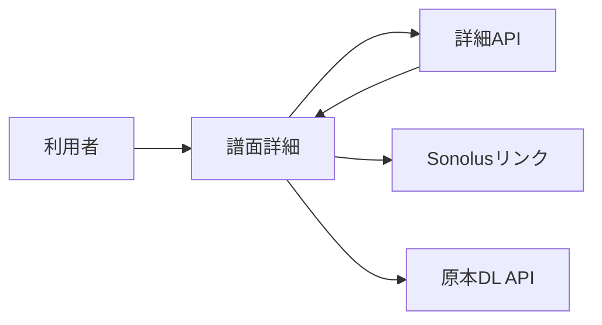

# 譜面詳細画面 詳細設計書

## 1. 文書情報

| 項目 | 内容 |
|---|---|
| 文書名 | 譜面詳細画面 詳細設計書 |
| 対象機能 | 詳細データ表示、変換中ポーリング、譜面操作リンク |
| 対象システム | `rp-frontend/` |
| バージョン | 1.0 |
| 作成日 | 2026-10-25 |
| 対応する仕様調査書 | [frontend_仕様調査書.md](../../00_基本仕様/frontend_仕様調査書.md) |
| 関連設計書 | [譜面検索画面](./譜面検索画面.md)、[バックエンド詳細](../backend/譜面詳細・自分の譜面.md) |

## 2. 機能概要

`chartId` に対応する詳細を取得して譜面情報、作者、ジャケット、変換状態を表示する。所有者・moderator には編集導線を、原本公開または本人・moderator にはダウンロード導線を出す。

## 3. 機能仕様

- component mount または chartId 変更時に詳細を取得する。
- conversion status が完了値でなければ3秒後に再取得し、変換中表示を出す。
- loading は skeleton、エラーはエラーパネルで表示。
- Sonolus link は現在 origin host と chart ID から生成する。
- `detail.originalChart` がある場合、または本人/moderator の場合に原本ダウンロード link を表示。

## 4. 詳細設計

1. effect 内で AbortController を作り、`fetchChartDetail` を呼ぶ。
2. 成功後、chart detail を ID と紐づけて state に保存する。
3. conversion status が未完了なら `setTimeout(load, 3000)` で polling を登録する。
4. chartId 変更・unmount では fetch abort と timer clear を実施する。AbortError は UI error にしない。
5. fetch error は message を状態に格納する。
6. render 時に user ID/permission と detail を比較して canEdit/canDownload を算出し、対応 control を描画する。

## 5. データフロー図

## 6. 入出力・データ設計

| データ | 項目 |
|---|---|
| 入力 | route parameter `chartId`、AuthContext user |
| 詳細 API | `GET /api/chart?chart_id=...` |
| 表示状態 | detail/error/loading、変換中 status |
| 外部リンク | `https://open.sonolus.com/{host}/levels/{encoded chart id}` |
| download | `/api/chart/download?chart_id={encoded id}` |

根拠: [ChartDetail.tsx](../../../rp-frontend/src/components/ChartDetail.tsx)、[api.ts](../../../rp-frontend/src/lib/api.ts)、[constants.ts](../../../rp-frontend/src/lib/constants.ts)

## 7. エラー・例外・制約

- 取得失敗は error panel。AbortError は無視。
- polling の上限回数や総 timeout は設けられていない。一定間隔で完了まで取得を続ける。
- 権限表示は画面制御であり、実ファイル/APIアクセス権限は backend が検査する。

## 8. 設定・外部依存

Backend chart API、認証 context、Sonolus external link、window origin に依存する。

## 9. テスト観点

- API loading/error/success、chartId 切替、unmount時のcleanup。
- conversion 完了/未完了 polling と3秒間隔。
- owner/moderator/一般利用者の edit/download 表示。
- jacket 欠落、private 表示、URL encode。
- 自動テスト実行スクリプトは確認できない。

## 10. バージョン履歴

| バージョン | 日付 | 変更内容 |
|---|---|---|
| 1.0 | 2026-10-25 | 初版作成 |
