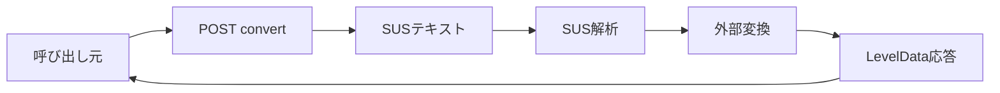

# SUS テキスト変換 詳細設計書

## 1. 文書情報

| 項目 | 内容 |
|---|---|
| 文書名 | SUS テキスト変換 詳細設計書 |
| 対象機能 | `POST /convert` の SUS fallback |
| 対象システム | `rp-level-converter/` |
| バージョン | 1.0 |
| 作成日 | 2026-10-25 |
| 対応する仕様調査書 | [level-converter_仕様調査書.md](../../00_基本仕様/level-converter_仕様調査書.md) |
| 関連設計書 | [USC JSON 変換](./USC JSON変換.md)、[ローカル USC 変換](./USC共通変換モジュール.md) |

## 2. 機能概要

gzip LevelData と USC JSON の両処理が例外になった場合、元 body を SUS text とみなし、依存エンジンの `susToUSC` と外部 `uscToLevelData` で LevelData を生成する。

## 3. 機能仕様

- Input は request body の UTF-8 decode 結果。
- SUS parse は `@next-sekai/sonolus-next-sekai-engine` の `susToUSC`。
- SUS から得た USC は同 package の外部 `uscToLevelData` に渡す。ローカル `uscToLevelData` は使わない。
- 成功時 `chartformat=sus`、失敗時 HTTP 500 JSON `{error: String(e)}`。

## 4. 詳細設計

1. LevelData gzip/JSON、USC JSON 各段階が catch されると SUS stage に到達する。
2. `susToUSC(chartText)` を実行する。
3. 生成 USC を `externalUscToLevelData` に渡し leveldata に設定する。
4. 成功時は共通 JSON response へ進む。
5. SUS parse または外部 converter の例外時、例外文字列を JSON にし status 500 で返す。

## 5. データフロー図

## 6. 入出力・データ設計

| 項目 | 形式 |
|---|---|
| Request body | SUS UTF-8 bytes |
| Intermediate | 外部 engine USC |
| Response | `{chartformat: "sus", leveldata: ...}` |
| Error | HTTP 500 `{error: string}` |

根拠: [src/index.ts](../../../rp-level-converter/src/index.ts)、[package.json](../../../rp-level-converter/package.json)

## 7. エラー・例外・制約

- 形式判定は各段階の例外を契機に順次 fallback する。Content-Type や format header 判定はない。
- 500 は最後の SUS 処理の例外文字列のみを返し、先行する gzip/USC parse exception は返さない。
- SUS の最大入力サイズ、timeout、validation report は route 上確認できない。

## 8. 設定・外部依存

`@next-sekai/sonolus-next-sekai-engine`、Node/Hono runtime に依存する。

## 9. テスト観点

- SUS fixture の正常変換と `chartformat`。
- 不正 SUS、空入力、上流2形式失敗後の最終500 body。
- 外部 converter 例外。
- `test/` 内 fixture はあるが package script に自動実行定義は確認できない。

## 10. バージョン履歴

| バージョン | 日付 | 変更内容 |
|---|---|---|
| 1.0 | 2026-10-25 | 初版作成 |
