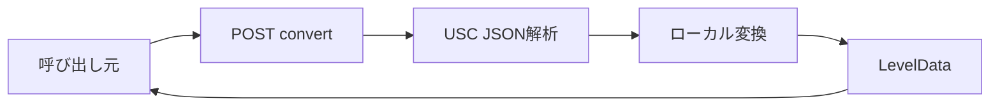

# USC JSON 変換 詳細設計書

## 1. 文書情報

| 項目 | 内容 |
|---|---|
| 文書名 | USC JSON 変換 詳細設計書 |
| 対象機能 | `POST /convert` の USC JSON fallback |
| 対象システム | `rp-level-converter/` |
| バージョン | 1.0 |
| 作成日 | 2026-10-25 |
| 対応する仕様調査書 | [level-converter_仕様調査書.md](../../00_基本仕様/level-converter_仕様調査書.md) |
| 関連設計書 | [LevelData 受け入れ](./gzip LevelData受け入れ.md)、[ローカル USC 変換](./USC共通変換モジュール.md) |

## 2. 機能概要

gzip LevelData 経路で例外が発生した後、元 body を UTF-8 JSON として parse し、トップレベル `usc` をローカル変換器に渡す。仕様調査書はコードを根拠に実際の変換形式を記述する。

## 3. 機能仕様

- JSON top-level の `usc` property を USC input として扱う。
- 変換器は `usc.offset + offset`（HTTP route の offset は省略時0）を `bgmOffset` とし、entity list を生成する。
- 対応 entity: BPM、time scale group/change、single/damage note、slide、guide。未知 object の処理は型上の exhaustive assertion。
- 成功時 `chartformat=usc`。USC schema の独立した runtime validation はない。

## 4. 詳細設計

1. raw request body を UTF-8 文字列へ変換する。
2. `JSON.parse(chartText).usc` を読み取る。field の存在・schema 検証は行わない。
3. `localUscToLevelData(usc)` を呼ぶ。HTTP route では optional offset を明示せず0を使う。
4. converter は初期 life 1000 の Initialization entity を作成し、time scale group を準備、BPM entity、time scale changes、各 note entity を順に追加する。
5. note names は整数を16進数文字列にして連番で付ける。single/flick/trace 等で archetype と data を設定する。
6. slides は connection の entity/ref chain、segment、connector を生成する。Guide は midpoint が2個未満なら変換されない。SimLine candidate を集め、最後に SimLine を追加する。
7. `LevelData {bgmOffset, entities}` を共通成功応答で返す。

## 5. データフロー図

## 6. 入出力・データ設計

| 項目 | 内容 |
|---|---|
| Request | UTF-8 JSON。`usc` property が必要 |
| USC主要項目 | `offset`, `objects`。object type ごとに固有データ |
| Output | `bgmOffset: number`, `entities: LevelDataEntity[]` |
| Entity | `archetype` と `data[]`; data は `value` または `ref` |
| Response | `{ "chartformat": "usc", "leveldata": ... }` |

根拠: [src/index.ts](../../../rp-level-converter/src/index.ts)、[usc2levedata.ts](../../../rp-level-converter/src/usc/usc2levedata.ts)、[type.ts](../../../rp-level-converter/src/usc/type.ts)

## 7. エラー・例外・制約

- JSON parse、欠落 `usc`、不正 shape、変換中例外はこの段階で catch され、SUS text fallback に続く。
- Guide midpoint が2未満の場合は例外ではなく、その guide entity を追加しない。
- 全 USC data/engine semantics の互換性はコード上では確認できない。

## 8. 設定・外部依存

TypeScript local conversion module と `@sonolus/core` / USC type declarations に依存する。HTTP entry point は local converter を利用する。

## 9. テスト観点

- USC JSON 正常、JSON不正、usc欠落、objects type 分岐。
- offset 計算、BPM・time scale group/change、各 note archetype。
- slide attach/interpolation/connector、guide 1 midpoint と2 midpoint、SimLine候補。
- 自動テスト runner/script は確認できない。`test/` fixtures を test script が実行する定義も確認できない。

## 10. バージョン履歴

| バージョン | 日付 | 変更内容 |
|---|---|---|
| 1.0 | 2026-10-25 | 初版作成 |
