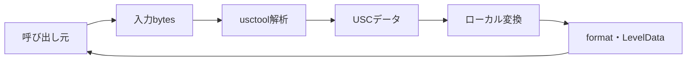

# USC 共通変換モジュール 詳細設計書

## 1. 文書情報

| 項目 | 内容 |
|---|---|
| 文書名 | USC 共通変換モジュール 詳細設計書 |
| 対象機能 | `usctool` による入力識別と USC→LevelData 関数 |
| 対象システム | `rp-level-converter/` |
| バージョン | 1.0 |
| 作成日 | 2026-10-25 |
| 対応する仕様調査書 | [level-converter_仕様調査書.md](../../00_基本仕様/level-converter_仕様調査書.md) |
| 関連設計書 | [USC JSON 変換](./USC JSON変換.md)、[SUS 変換](./SUSテキスト変換.md) |

## 2. 機能概要

`src/usc/convert.ts` は `Uint8Array` を `usctool.anyToUSC` で解析し、返された USC をローカル LevelData converter に渡して `{format, leveldata}` を返す。本関数は HTTP `src/index.ts` の `/convert` handler から呼び出されていない。

## 3. 機能仕様

- 入力は `Uint8Array`。入力形式の識別と USC 化は `anyToUSC` に委譲する。
- `uscToLevelData` の返却値を leveldata とし、usctool の format 値をそのまま format として返す。
- offset 引数を渡さないため local converter の既定 offset 0 が用いられる。
- 変換エラーを catch・再包装せず、呼出元へ伝播する。

## 4. 詳細設計

1. `convert(buffer)` に受け取った buffer を `anyToUSC` に渡す。
2. `{format, usc}` を destructure する。
3. `uscToLevelData(usc)` を呼び出す。
4. `{format, leveldata}` を返す。
5. module barrel `src/usc/index.ts` は `convert` と `uscToLevelData` を re-export する。

## 5. データフロー図

## 6. 入出力・データ設計

| 項目 | 型 | 内容 |
|---|---|---|
| `buffer` | `Uint8Array` | formatを特定する入力 bytes |
| `format` | usctool の format | 元形式識別子 |
| `leveldata` | `LevelData` | `bgmOffset`, `entities` |

根拠: [src/usc/convert.ts](../../../rp-level-converter/src/usc/convert.ts)、[src/usc/index.ts](../../../rp-level-converter/src/usc/index.ts)、[src/usc/usc2levedata.ts](../../../rp-level-converter/src/usc/usc2levedata.ts)、[src/usc/type.ts](../../../rp-level-converter/src/usc/type.ts)

## 7. エラー・例外・制約

- `anyToUSC` またはローカル変換器の例外処理はない。
- HTTP endpoint がこの helper を使用していないため、helper の input format coverage と HTTP route coverage は同一ではない。
- usctool が返す format の完全な値域は dependency package に依存し、コード上では列挙されていない。

## 8. 設定・外部依存

`usctool`、ローカル USC→LevelData converter、TypeScript module runtime に依存する。

## 9. テスト観点

- USC/SUS その他 usctool が扱う入力 bytes と返却 format。
- malformed bytes、unsupported format、変換中例外の伝播。
- helper を `/convert` が呼んでいない現行 wiring の確認。
- 自動テスト runner/script は package.json にない。

## 10. バージョン履歴

| バージョン | 日付 | 変更内容 |
|---|---|---|
| 1.0 | 2026-10-25 | 初版作成 |
