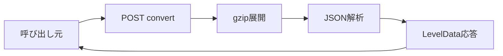

# gzip LevelData 受け入れ 詳細設計書

## 1. 文書情報

| 項目 | 内容 |
|---|---|
| 文書名 | gzip LevelData 受け入れ 詳細設計書 |
| 対象機能 | `POST /convert` の gzip LevelData 経路 |
| 対象システム | `rp-level-converter/` |
| バージョン | 1.0 |
| 作成日 | 2026-10-25 |
| 対応する仕様調査書 | [level-converter_仕様調査書.md](../../00_基本仕様/level-converter_仕様調査書.md) |
| 関連設計書 | [USC JSON 変換](./USC JSON変換.md)、[SUS 変換](./SUSテキスト変換.md) |

## 2. 機能概要

`POST /convert` の raw body を gzip として展開し、UTF-8 JSON parse に成功した場合、既存 LevelData として返却する。変換を行わず、parse 後の JSON value を出力に使用する。

## 3. 機能仕様

- Request body は `arrayBuffer()` で全量読み込み。
- gunzip の `maxOutputLength` は `100 * 1024 * 1024` bytes。ソースコメントには10 MiBと記載されるが、実際の定数値は100 MiB。
- 展開後 UTF-8 JSON.parse 成功時 `chartformat=leveldata`。
- plain uncompressed LevelData JSON をこの経路で受け入れる処理ではない。失敗時は USC JSON → SUS fallback に進む。
- 成功応答は HTTP 200 JSON `{chartformat, leveldata}`。

## 4. 詳細設計

1. Hono request body を arrayBuffer で読み、`chartBuffer` とする。
2. promisified `gunzip` に `maxOutputLength` を渡す。
3. 展開 bytes を UTF-8 string 化して JSON.parse し、結果を leveldata に設定する。
4. 2〜3 の成功で chartFormat を `leveldata` とし、共通成功応答を返す。
5. gunzip/parse の例外は局所 catch され、元 bytes を使った次の形式判定へ継続する。

## 5. データフロー図

## 6. 入出力・データ設計

| 項目 | 型・制約 |
|---|---|
| Request body | gzip compressed bytes |
| 展開後サイズ | 最大100 MiB（実際の定数値） |
| JSON | LevelData として期待されるが、schema validation はない |
| Response | `{ "chartformat": "leveldata", "leveldata": <parsed JSON> }` |

根拠: [src/index.ts](../../../rp-level-converter/src/index.ts)、[src/usc/type.ts](../../../rp-level-converter/src/usc/type.ts)

## 7. エラー・例外・制約

- gzip 破損、展開サイズ超過、UTF-8/JSON parse 失敗時はエラー応答にせず次形式に fallback。
- Parsed object が LevelData schema に適合するか確認しない。
- raw input body 自体の上限設定はこの route で確認できない。

## 8. 設定・外部依存

Node zlib gunzip、JSON parser、Hono に依存する。

## 9. テスト観点

- 正常 gzip LevelData、破損 gzip、invalid JSON、展開後100 MiB上限近傍。
- 100 MiB超過と fallback 経路。
- schema 不正なJSONが形式判定を通る現行挙動。
- 自動テスト runner/script は確認できない。

## 10. バージョン履歴

| バージョン | 日付 | 変更内容 |
|---|---|---|
| 1.0 | 2026-10-25 | 初版作成 |
