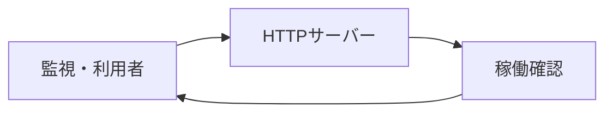

# 稼働確認・HTTP 起動 詳細設計書

## 1. 文書情報

| 項目 | 内容 |
|---|---|
| 文書名 | 稼働確認・HTTP 起動 詳細設計書 |
| 対象機能 | Hono HTTP service、`GET /` |
| 対象システム | `rp-level-converter/` |
| バージョン | 1.0 |
| 作成日 | 2026-10-25 |
| 対応する仕様調査書 | [level-converter_仕様調査書.md](../../00_基本仕様/level-converter_仕様調査書.md) |
| 関連設計書 | [LevelData 受け入れ](./gzip LevelData受け入れ.md)、[変換 API](./USC JSON変換.md) |

## 2. 機能概要

Hono application を Node server として起動し、ルート `GET /` にプレーンテキスト `ok` を返す。アプリケーションの固定 listen port は5003。

## 3. 機能仕様

- `GET /` は `text/plain` の `ok` を返す。
- `/convert` の主要な処理は別設計書を参照。
- ソース上に認証、route別アクセス制御、health check dependency は確認できない。
- Dockerfile は `EXPOSE 5005` だが app listen は5003。コンテナ port forwarding の実構成との整合性は要確認。

## 4. 詳細設計

1. `Hono` instance を生成する。
2. `/` GET handler を登録し `c.text("ok")` を返す。
3. `serve({fetch: app.fetch, port: 5003})` により Node HTTP server を起動し、起動時に localhost URL を標準出力へ記録する。

## 5. データフロー図

## 6. 入出力・データ設計

| 項目 | 内容 |
|---|---|
| Request | `GET /` |
| Response | status 200、text `ok` |
| Listen port | 5003 |

根拠: [src/index.ts](../../../rp-level-converter/src/index.ts)、[Dockerfile](../../../rp-level-converter/Dockerfile)

## 7. エラー・例外・制約

起動失敗時・health endpoint の異常状態を個別に扱う処理は確認できない。Container `EXPOSE 5005` と実 listen `5003` の連携設定は要確認。

## 8. 設定・外部依存

Node.js、`@hono/node-server`、Hono に依存する。

## 9. テスト観点

- `/` が `ok` を返すこと。
- 5003 listen とコンテナ公開 port の設定整合。
- 起動時の bind/error handling。自動テスト script は package.json にない。

## 10. バージョン履歴

| バージョン | 日付 | 変更内容 |
|---|---|---|
| 1.0 | 2026-10-25 | 初版作成 |
