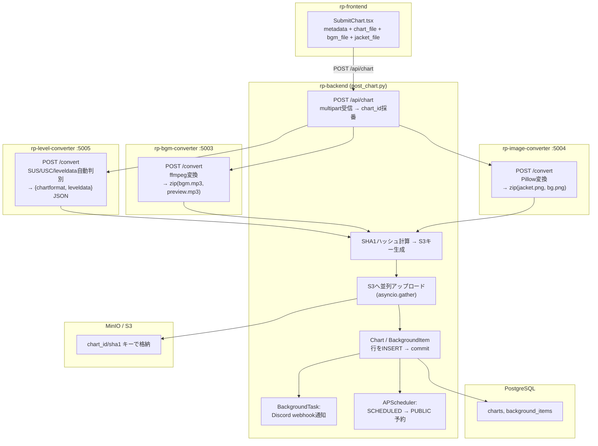
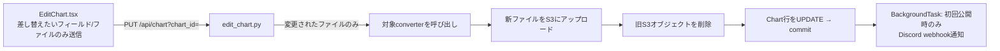
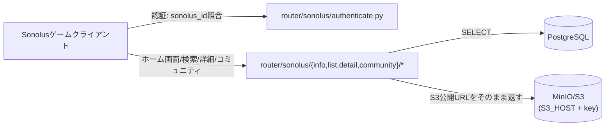

# RhythmPrism Value Stream Map

このドキュメントは各サービスの実装を毎回読み直す代わりに参照する、処理フローのスナップショット。
機械可読版は [vsm.json](vsm.json)。**コードが正であり、このファイルは補助**。大きな構成変更（エンドポイント追加/削除、サービス間呼び出しの変更）をしたら追従して更新すること。

作成時点: 2026-07-15 時点のソースを rp-backend / rp-frontend / rp-bgm-converter / rp-image-converter / rp-level-converter / docker-compose / nginx.conf から調査して作成。

## サービス一覧とポート

| サービス | 役割 | ポート | 依存 |
|---|---|---|---|
| nginx | リバースプロキシ (`/api`,`/sonolus` → backend, それ以外 → frontend) | 80 | frontend, backend |
| rp-frontend | Web UI (React SPA) | 5000 | backend のみ（converterへの直接依存なし） |
| rp-backend | REST API 兼 Sonolusプロトコル実装 | 5001 | postgres, s3(MinIO), 3つのconverter |
| postgres | メインDB | 5002→5432 | - |
| s3 (MinIO, dev環境のみ) | オブジェクトストレージ。本番はAWS S3想定 | 9000/9001 | - |
| rp-bgm-converter | 音源変換 (ffmpeg) | 5003 | s3依存なし（バイトを返すのみ） |
| rp-image-converter | ジャケット/背景画像変換 (Pillow) | 5004 | s3依存なし（バイトを返すのみ） |
| rp-level-converter | 譜面(USC/SUS)変換 (Hono) | 5005 | s3依存なし（JSONを返すのみ） |

**重要な設計:** 3つのconverterはすべてステートレスな「バイト/JSON in → バイト/JSON out」の変換器で、
S3やDBには一切触れない。ストレージへの永続化・DB書き込みは常に **rp-backend側の責務**。

## 主要フロー 1: 譜面投稿 (post_chart)

ユーザーが rp-frontend の `SubmitChart.tsx` から譜面ファイル・BGM・ジャケット画像・メタデータを送信し、
公開可能な譜面としてDB+S3に保存されるまでの流れ。

- 3つのconverter呼び出しは並行に実行できる独立処理（互いに依存しない）。
- `utils/convert.py` が3つの converter クライアントの実体（`convert_chart` / `convert_bgm` / `convert_jacket`）。
- 環境変数 `LEVEL_CONVERTER_URL` / `BGM_CONVERTER_URL` / `IMAGE_CONVERTER_URL`（`const/env.py`）でURL解決。

## 主要フロー 2: 譜面編集 (edit_chart)

投稿フローとほぼ同じだが、フィールド単位で差分適用する点が異なる。

## 主要フロー 3: Sonolus クライアントからの読み取り

ゲームクライアント（Sonolus本体）は変換を一切行わず、公開済みDB行とS3の公開URLをそのまま返すだけ。

## 主要フロー 4: 認証（2系統が独立に存在）

- **Web (rp-frontend)**: Discord OAuth2 → `router/web/user/discord.py` → `User` 作成/更新 → httpOnly JWT cookie（`access_token`/`refresh_token`）。以後 `utils/dependencies.get_current_user_id` がcookieを検証。
- **Sonolusゲームクライアント**: `router/sonolus/authenticate.py` が `sonolus_id` で `User` と紐付け、Sonolus専用セッションIDを発行。Web用JWTとは別物。
- 2つのアカウントを紐付けるのが `router/web/user/sonolus.py`（Sonolusアカウント連携）。

## トークン節約のための使い方（AIエージェント向け）

- 「どのサービスが何を呼ぶか」を確認したいだけなら、このファイルと [vsm.json](vsm.json) を読めば rp-backend の `utils/convert.py` や各converterの `main.py` を毎回読み直す必要はない。
- 実装の詳細（バリデーション、エラーハンドリング、具体的なフィールド名等）はここには含めていない。ロジック修正が必要な場合は該当ファイル（下記 `key_files` in vsm.json）を直接読むこと。
- このファイルは構造が変わった時だけ更新すればよい。日々の実装差分は追従不要。
